# vellum

A house figure style for research write-ups, as a one-call chart library.

The look: a white background, a Newsreader serif title that states the finding, coral for the baseline and blue
for the intervention, direct value labels, light gridlines and no chart junk. Vertical bars follow the look of the
Anthropic blog; horizontal bars, heatmaps, tiles and cards aim for the clearest possible reading.

```python
import vellum as vl

vl.hbar({"Closed book": 41.0, "Search snippets": 63.5, "Full documents": 88.0},
        highlight="Full documents", decimals=0,
        notes={"Closed book": "164 of 400", "Search snippets": "254 of 400", "Full documents": "352 of 400"},
        title="Full documents raised correct answers from 41% to 88%",
        ).save("fig.png")
```

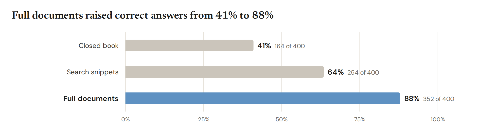

Every chart returns a `Figure`. `.save()` picks the format from the extension:

| Extension | What you get |
|---|---|
| `.png` | 2x raster (2016 px wide), rendered by headless Chromium. For Discord, Slack and slides. |
| `.pdf` | Vector PDF with the fonts embedded. For papers. |
| `.svg` | One SVG with the used glyphs embedded. It renders the same anywhere and opens in Figma or Illustrator. |
| `.html` | A standalone page. `fig.html(standalone=False)` gives a `<figure>` to paste into an artifact. |

`fig.svg()` returns the SVG string. In Jupyter a figure displays itself.

## Install

Clone the repo to `~/dev/vellum`, where the skill tells Claude to find it, and run `install.sh`:

```bash
gh repo clone safety-research/vellum ~/dev/vellum
~/dev/vellum/install.sh
```

It links the Claude Code skill in `claude/skills/vellum` into `~/.claude/skills/` and installs the headless
Chromium that renders PNG and PDF. The clone is the installation: edit the skill in the repo, and `git pull`
updates it. Re-running is safe, and `VELLUM_NO_BROWSER=1` skips the Chromium step.

## Using it from any project

A one-off script can use it straight from the clone:

```bash
uv run --with-editable ~/dev/vellum python make_figs.py
```

Add it to a project:

```bash
uv add --editable ~/dev/vellum
```

To make a figure without writing Python, put a JSON spec in a file (a list of specs makes several figures):

```bash
uvx --from ~/dev/vellum vellum render spec.json -o fig.png
```

```json
{"chart": "hbar", "data": {"Closed book": 59, "With search": 12}, "highlight": "With search",
 "title": "With search, wrong answers fell from 59% to 12%"}
```

`vellum gallery -o out/` renders every example below. Rendering uses Playwright's headless Chromium, which
`install.sh` sets up.

## Style rules

### Words

Readers look at a figure's title first and remember it better than the chart, so the title carries the finding
and nothing else on the figure competes with it.

1. **The title states one finding, literally:** what was compared and what happened, in about 10 plain words.
   "With search, wrong answers fell from 59% to 12%", not "Wrong answers by setup" or "Search changes
   everything". If it needs a semicolon, make two figures.
2. **It names what the eye sees first**, the highlighted bar or the biggest gap. If the point is a small
   difference, change the chart (highlight it, drop other bars), not the words.
3. **It says what was measured, not what it means:** "rated the episode higher", not "felt better"; "chose to
   stop", not "wanted to stop".
4. **Plain words only.** No colon setups ("The fix: search"), mirrored phrasing ("A moved without B, and B
   without A"), metaphors, wordplay or questions, and no names coined inside a project, such as an arm's code
   name. Use numbers instead of adjectives: "fell from 41% to 28%", not "dropped sharply". Field terms the
   readers use daily are fine.
5. **No subtitle by default.** Add one only to say "Example data" when the numbers are made up, or what the
   error bars are ("Error bars are 95% intervals"). The measure and unit go in the axis label, or in the title
   when the chart has no axis label. Sample sizes, methods, training details and model names go in the text.
   If the measure needs a sentence to explain, show a simpler measure.
6. **Numbers get two significant digits** (41%, not 41.3%), and each condition keeps one name across a
   write-up.

### Look

7. **Keep color meanings fixed across a write-up.**
   - coral: the baseline, no intervention, or the bad outcome
   - blue: the intervention, or the point you are making
   - sage: a second kind of intervention (fine-tuning, a different prompt)
   - beige: untouched or reference
   - gray: everything else
8. **Use one accent.** `highlight=` colors the bar you are talking about and turns the rest gray.
9. **Label directly.** Write values at the bar tip and names at line ends, and keep legends small.
   Notes such as "412 chats" or "352 of 400" go after the value.
10. **Show intervals** (`ci=`) when the comparison depends on them, and say what they are in the subtitle.
11. **Mark example data** in the subtitle of any figure made before the real numbers exist.
12. **No caption at the bottom**, in the figure or under it in a write-up.

For a write-up, use `frame="blog"`. It gives a centered serif title and subtitle, with the legend below the chart.
`vl.set_defaults(frame="blog")` switches every figure.

## Charts

| Function | Use it for | Gallery |
|---|---|---|
| `hbar(data, ...)` | Rates by condition or model. One series, grouped series (`series=[...]`), `highlight`, `notes`, `ci`, a `ref` line, `vl.section("heading")` rows. | 01, 02, 07, 08 |
| `bars(data, ...)` | Vertical bars in the blog look: coral next to blue, value on top, whiskers, a dashed `ref` line, negative values. | 11, 12, 14 |
| `heatmap(data, ...)` | Model by condition tables. One hue (`scale="blue"`, `"coral"`, `"sage"`, `"green"`) or `"diverging"`, plus `col_groups`. | 05 |
| `tiles(grid, ...)` | Big-number tiles, such as a confusion matrix. Each `vl.Tile(value, lines, color, strong)`. | 03 |
| `waffle(parts, ...)` | "52 in 100" shares. | 16 |
| `scatter(points, ...)` | One dot per dataset or model, with labels, `diagonal=`, `trend="fit"` and annotations. | 04 |
| `dumbbell(data, ...)` | Before and after per model. | 15 |
| `line(series, ...)` | Curves over steps or doses, labeled at the end, with `bands`, `xscale="category"` or `"log"`. | 17 |
| `stacked(data, series=...)` | Where the outcomes went. | 18 |
| `panels([fig, fig, ...], cols=2)` | Small multiples with one shared legend. Each chart's title becomes its panel title. | 06, 11, 12 |
| `quotes(replies, prompt=...)` | A message and contrasting replies (`vl.Reply`). | 09 |
| `episodes([vl.Episode(...)])` | Transcript excerpts side by side: reasoning quote, tool call, outcome dot. | 13 |
| `code_card(name, params, description)` | A tool definition. | 10 |

Data can be `{label: value}`, `{label: [v1, v2]}` (grouped), a list of `(label, value)` pairs, or a pandas
Series or DataFrame. Values are percents by default (`37` means 37%). Pass `unit=""` for scores and means.
`decimals=`, `fmt="{:.1f}%"`, `domain=(lo, hi)` and `ticks=[...]` override the defaults.

Colors are names from `vl.PALETTE`: `coral`, `blue`, `sage`, `beige`, `gray`, `dark`, `light-blue`, `deep-blue`,
`navy`, `light-sage`, `deep-sage`, `light-coral` and `clay`. Hex values also work. Run `vellum colors` to list them.

## Gallery

Every number in these figures is made up. Error bars and bands are 95% intervals.

| | |
|---|---|
| 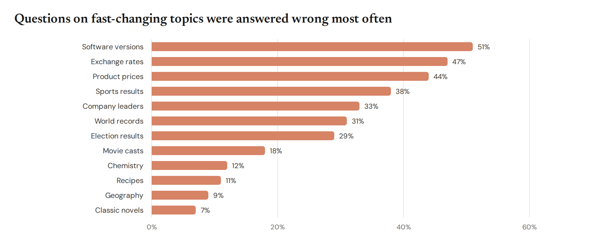 | 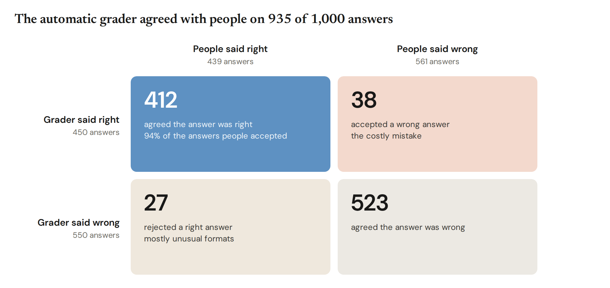 |
| 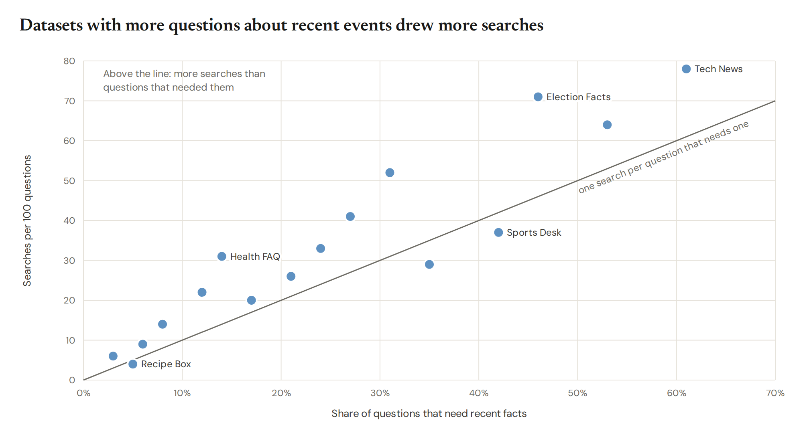 | 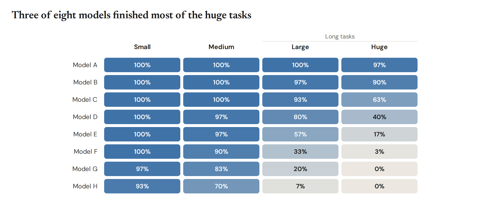 |
| 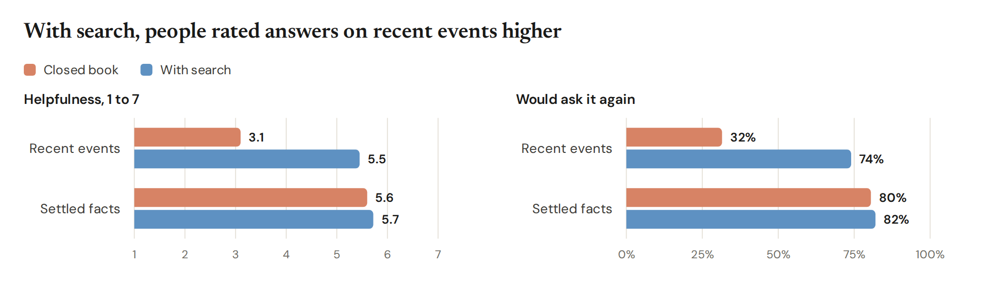 | 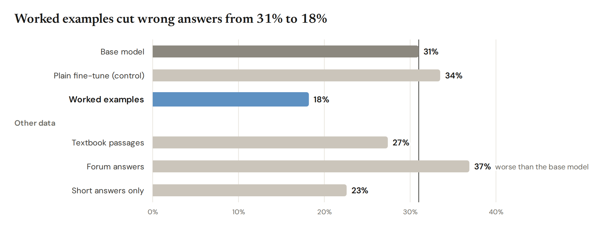 |
| 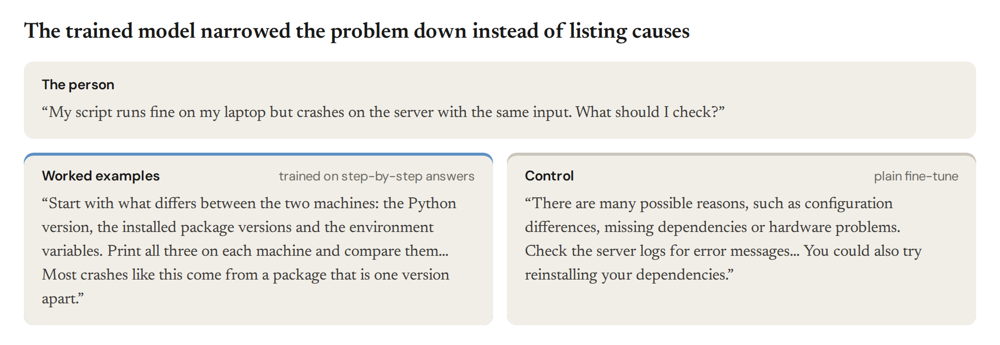 | 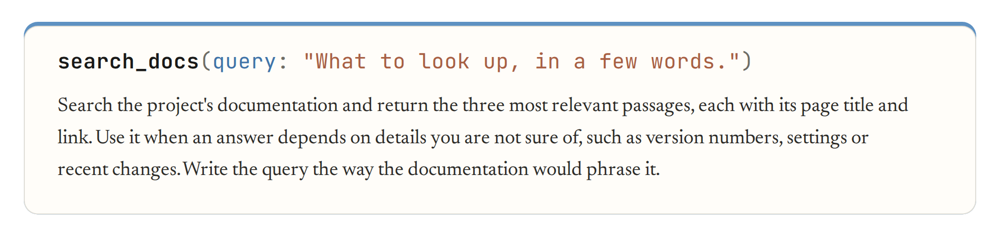 |
| 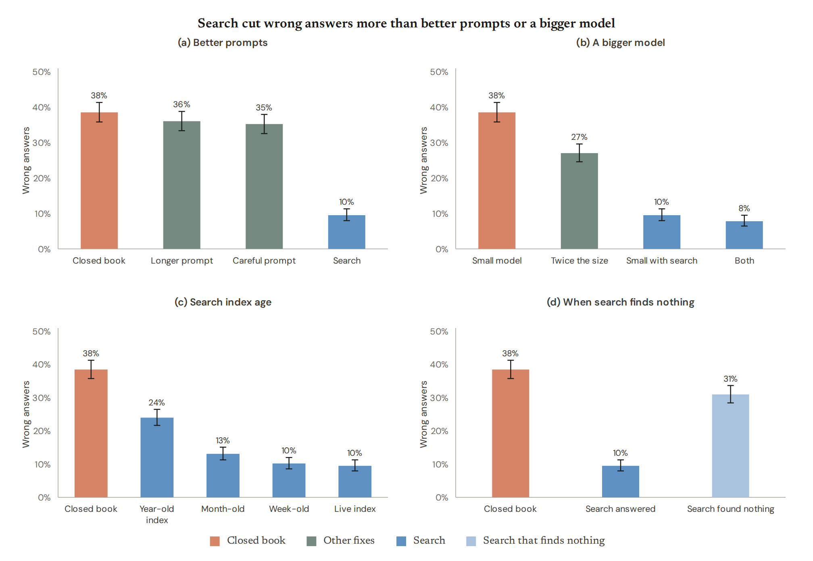 | 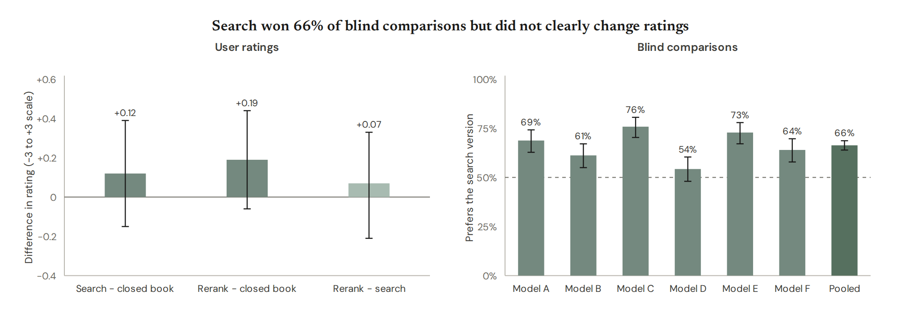 |
| 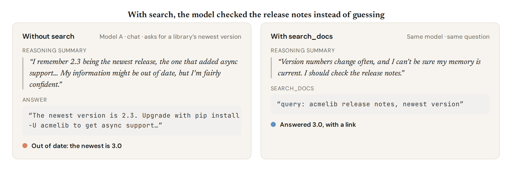 | 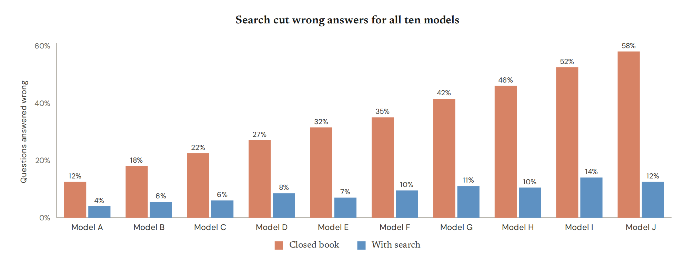 |
| 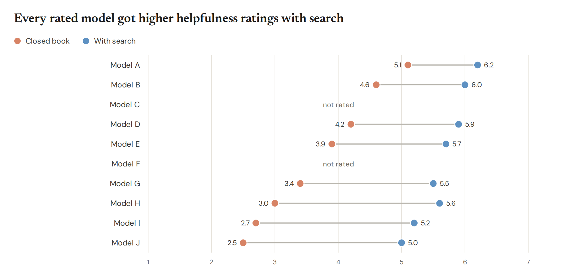 | 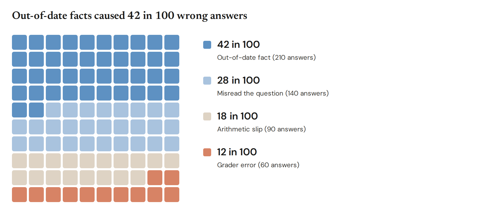 |
| 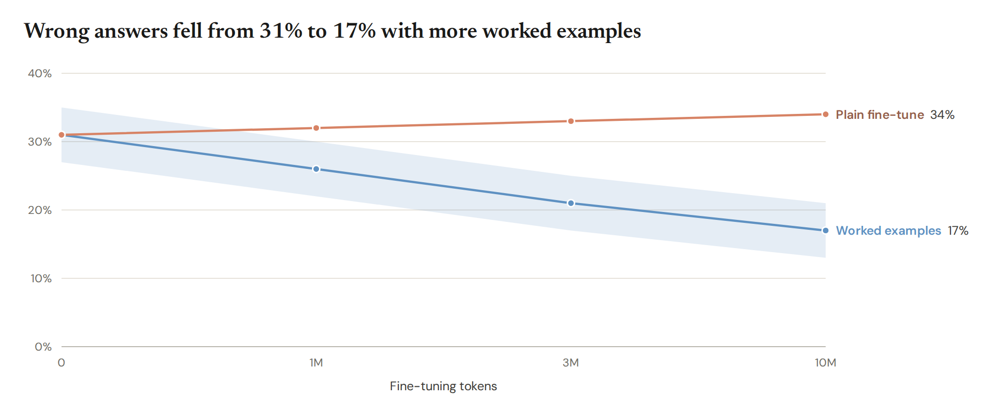 | 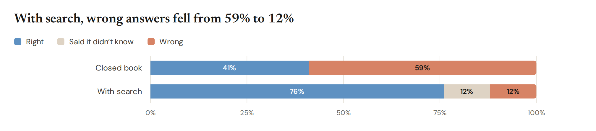 |

The source for every gallery figure is in `src/vellum/gallery.py`. Copy the closest one and change the numbers.

## How it works

Python builds one SVG per figure. Text is measured with the bundled font files: Newsreader, DM Sans and
JetBrains Mono, all under the OFL, in `src/vellum/fonts`. Labels, wrapping and margins are computed before
anything is drawn. One headless Chromium, started on first use and reused, turns the SVG into PNG or PDF in
about 0.1 s per figure. Run the tests with `uv run pytest`.
