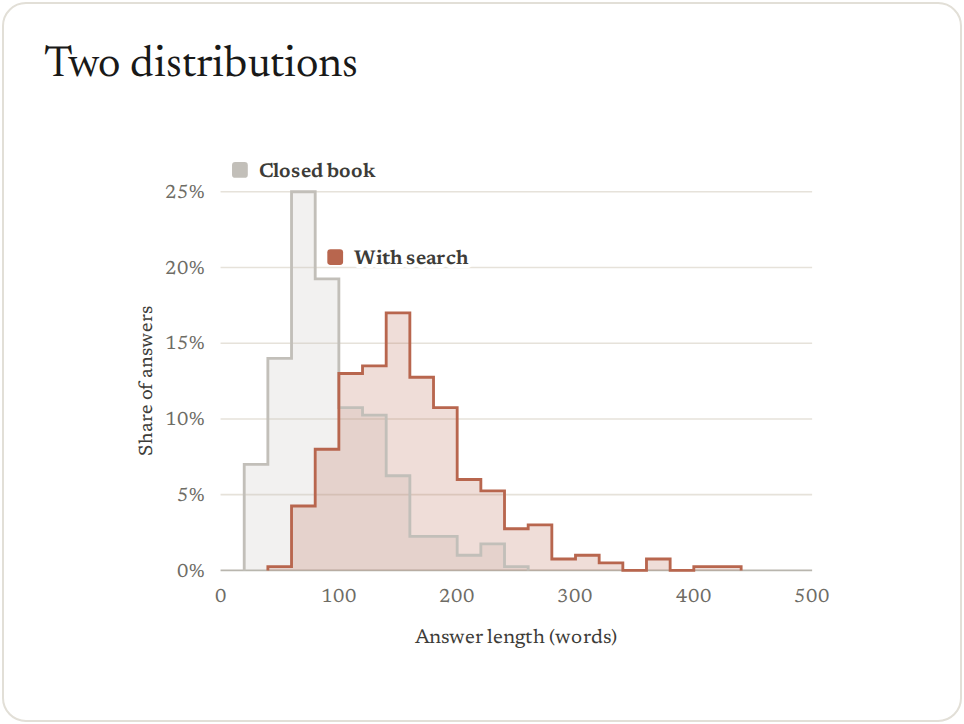
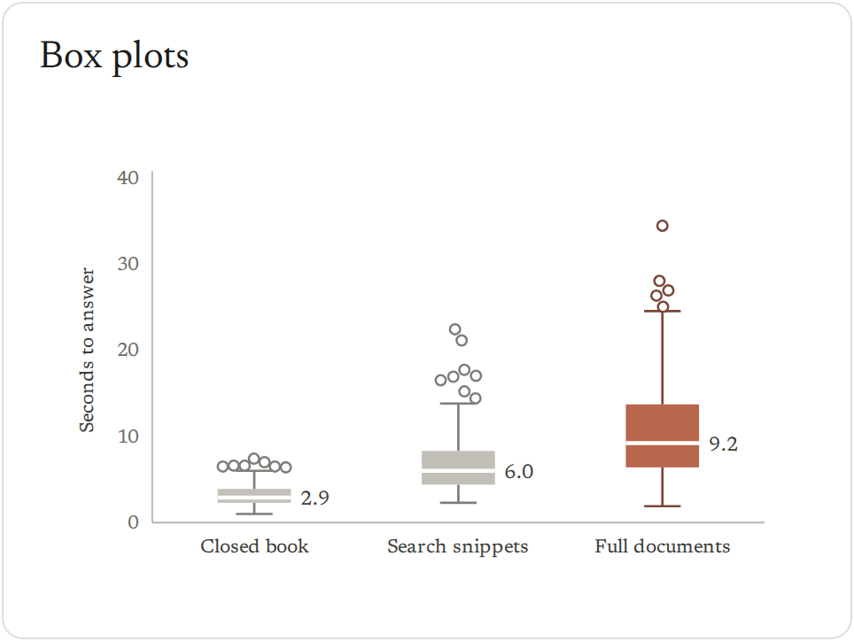
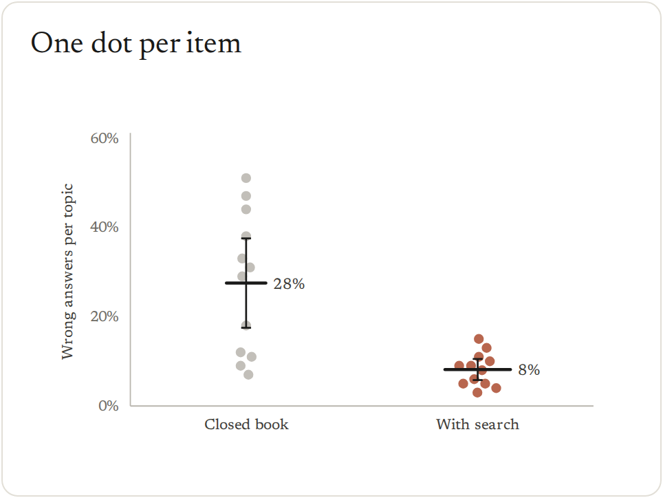
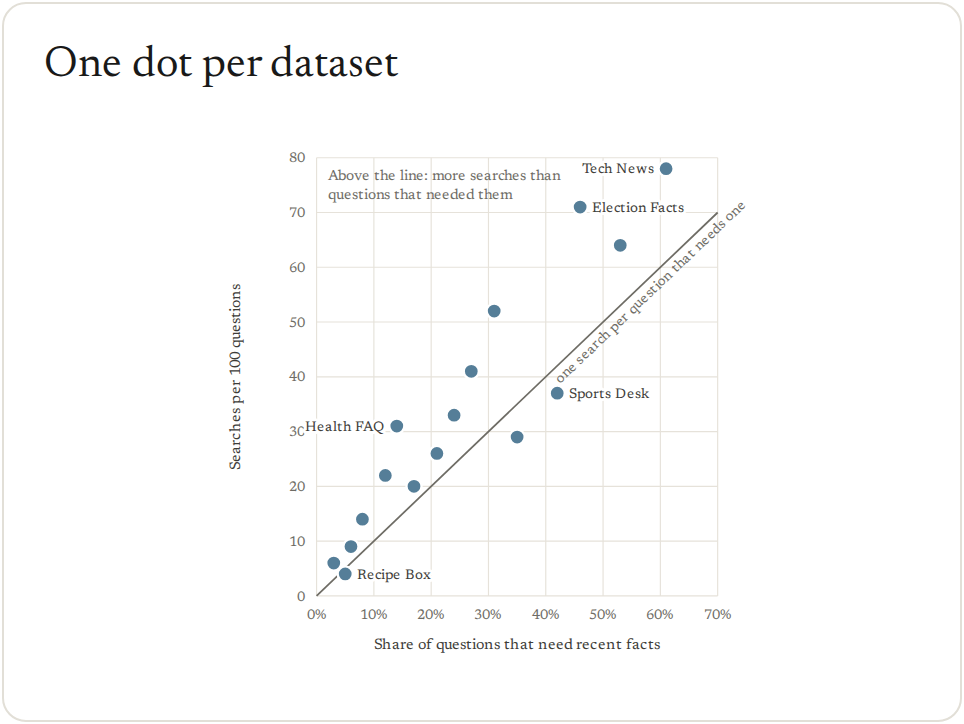
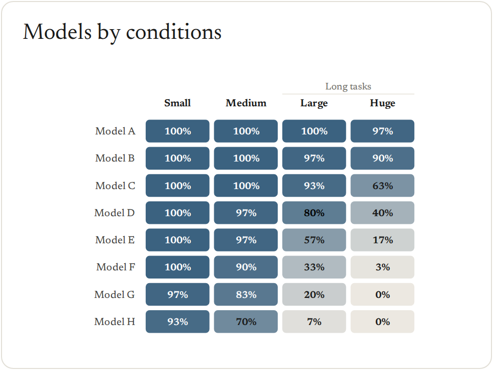
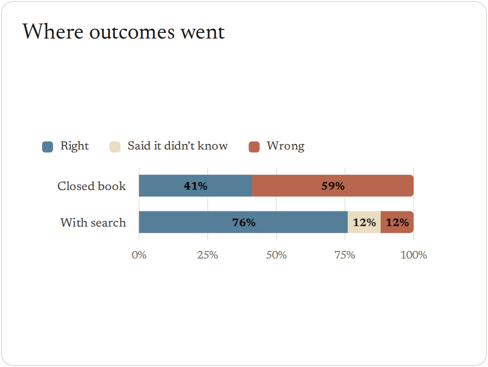
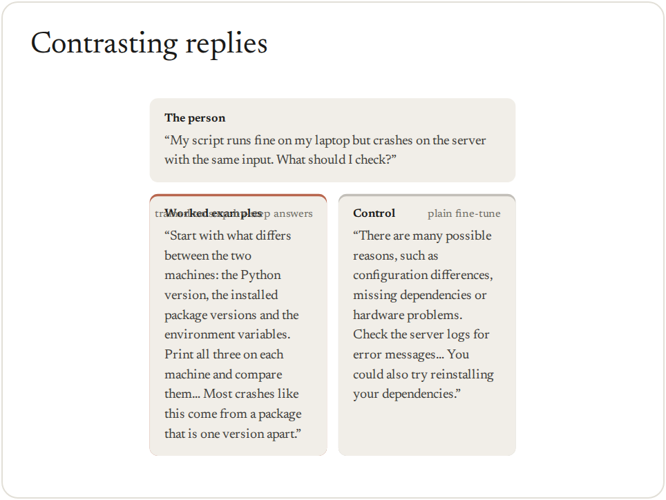

<picture>
  <source media="(prefers-color-scheme: dark)" srcset="docs/readme/dark/hero.png">
  
</picture>

<a href="#quick-start"><picture><source media="(prefers-color-scheme: dark)" srcset="docs/readme/dark/get-started.png"></picture></a>&nbsp;&nbsp;<a href="examples/README.md"><picture><source media="(prefers-color-scheme: dark)" srcset="docs/readme/dark/view-examples.png"></picture></a>


## Why viz?

<table>
<tr>
<td width="25%" valign="top"><picture><source media="(prefers-color-scheme: dark)" srcset="docs/readme/dark/icon-consistent.svg"></picture><br><br><b>Consistent</b><br>One visual language across a write-up: color roles, sizes and type that stay the same from figure to figure.</td>
<td width="25%" valign="top"><picture><source media="(prefers-color-scheme: dark)" srcset="docs/readme/dark/icon-quality.svg"></picture><br><br><b>High quality</b><br>Publication-ready by default: PDFs at the printed size, accessible color and text, and alt text on every figure.</td>
<td width="25%" valign="top"><picture><source media="(prefers-color-scheme: dark)" srcset="docs/readme/dark/icon-research.svg"></picture><br><br><b>Research-focused</b><br>The charts research needs: every run as a dot, effects with intervals, training curves and transcripts.</td>
<td width="25%" valign="top"><picture><source media="(prefers-color-scheme: dark)" srcset="docs/readme/dark/icon-productive.svg"></picture><br><br><b>Productive</b><br>One call per chart, a gallery to copy, and checks that flag problems before anyone reads the figure.</td>
</tr>
</table>

## Quick start

```bash
gh repo clone safety-research/viz && viz/install.sh
```

```python
import viz

viz.hbar({"Closed book": 41.0, "Search snippets": 63.5, "Full documents": 88.0}, highlight="Full documents",
         decimals=0, roles={"control": "Closed book", "intervention": "Full documents"},
         notes={"Closed book": "164 of 400", "Search snippets": "254 of 400", "Full documents": "352 of 400"},
         title="Full documents raised correct answers from 41% to 88%").save("fig.png")
```


`.save()` writes PNG, PDF, SVG or HTML, by the file's extension.

## Gallery

Every figure is a template for one kind of question. Click one for its code, copy it and change the numbers.
Every number here is made up, and error bars and bands are 95% intervals.

<!-- gallery: generated from src/viz/gallery.py -->
### Compare conditions

<a href="examples/README.md#rates-by-condition"></a>
<a href="examples/README.md#with-and-without-per-model"></a>
<a href="examples/README.md#every-run-as-a-dot"></a>
<a href="examples/README.md#effects-with-intervals"></a>
<a href="examples/README.md#before-and-after"></a>

### Show change over training

<a href="examples/README.md#training-curves"></a>

### Show a distribution

<a href="examples/README.md#two-distributions"></a>
<a href="examples/README.md#box-plots"></a>
<a href="examples/README.md#one-dot-per-item"></a>

### Show a relationship

<a href="examples/README.md#one-dot-per-dataset"></a>
<a href="examples/README.md#models-by-conditions"></a>

### Show where outcomes went

<a href="examples/README.md#where-outcomes-went"></a>

### Show what the model did

<a href="examples/README.md#contrasting-replies"></a>
<a href="examples/README.md#transcripts-side-by-side"></a>

### Lay out several figures

<a href="examples/README.md#panels-with-one-legend"></a>
<!-- /gallery -->

## Learn more

- [Guide](docs/guide.md): how to title, color and size a figure, and what the checks flag.
- [Reference](docs/reference.md): every chart and option, the command line and JSON specs.
- [Examples](examples/README.md): every template with its code.
