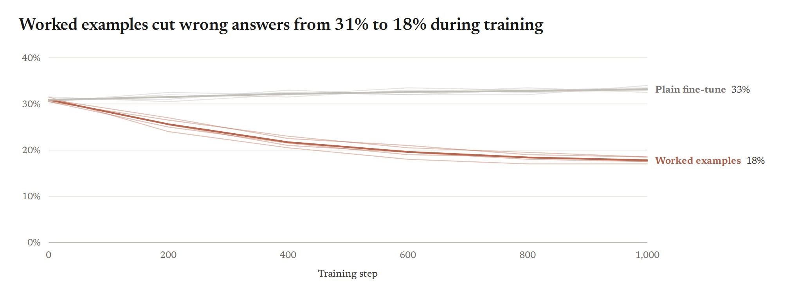
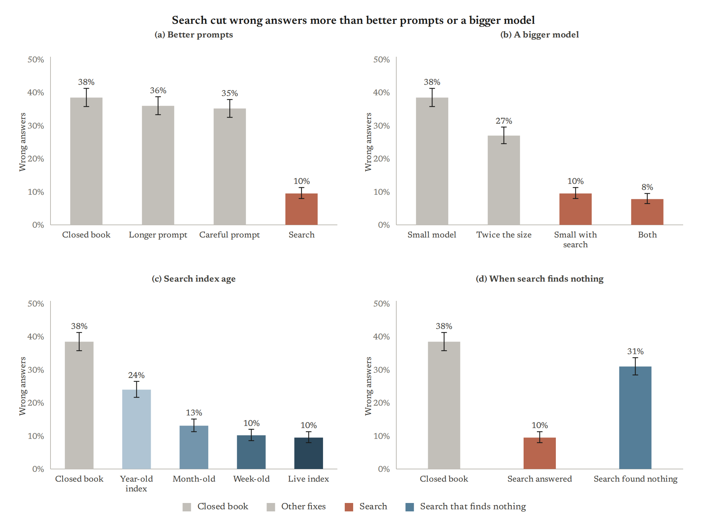
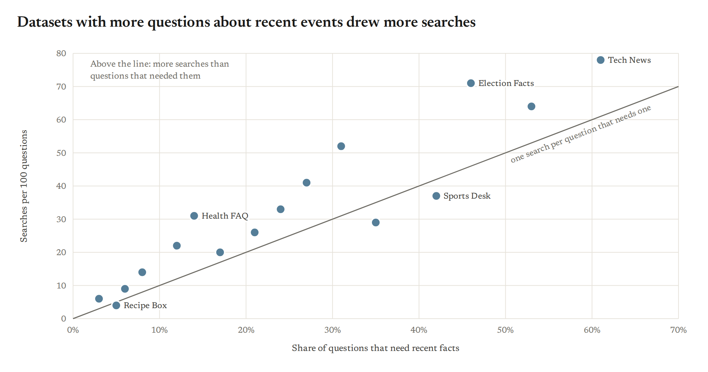
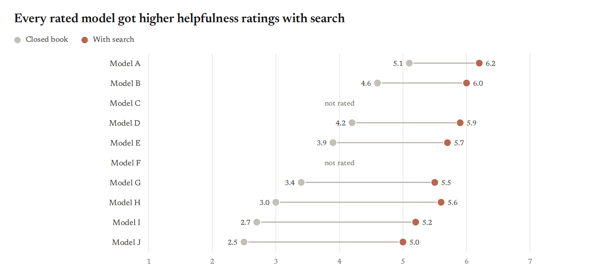
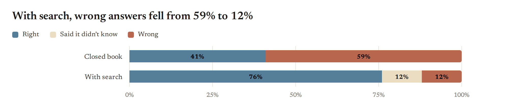
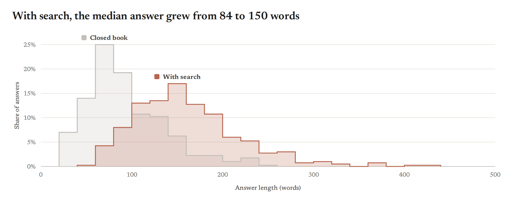
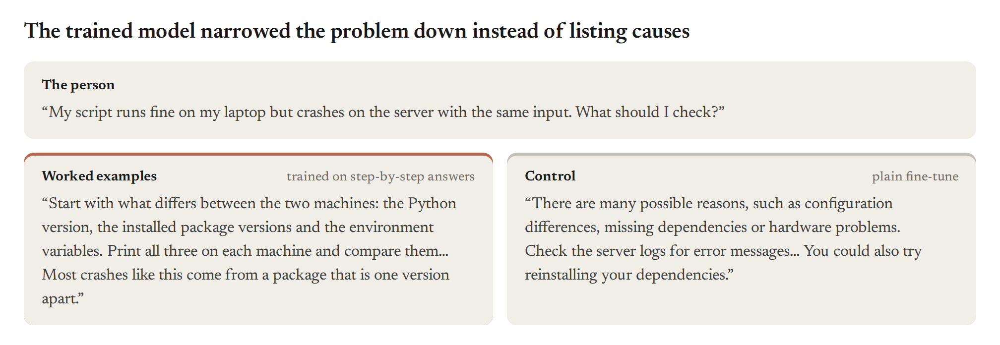
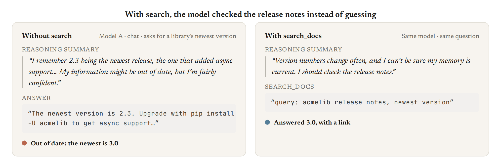

<a href="#install"></a>&nbsp;&nbsp;<a href="examples/README.md"></a>


## Why viz?

<table>
<tr>
<td width="25%" valign="top"><br><br><b>Consistent</b><br>One visual language across a write-up: color roles, sizes and type that stay the same from figure to figure.</td>
<td width="25%" valign="top"><br><br><b>High quality</b><br>Publication-ready by default: PDFs at the printed size, accessible color and text, and alt text on every figure.</td>
<td width="25%" valign="top"><br><br><b>Research-focused</b><br>The charts research needs: every run as a dot, effects with intervals, training curves and transcripts.</td>
<td width="25%" valign="top"><br><br><b>Productive</b><br>One call per chart, a gallery to copy, and checks that flag problems before anyone reads the figure.</td>
</tr>
</table>

## Quick start

```python
import viz

viz.hbar({"Closed book": 41.0, "Search snippets": 63.5, "Full documents": 88.0}, highlight="Full documents",
         decimals=0, roles={"control": "Closed book", "intervention": "Full documents"},
         notes={"Closed book": "164 of 400", "Search snippets": "254 of 400", "Full documents": "352 of 400"},
         title="Full documents raised correct answers from 41% to 88%").save("fig.png")
```


Every chart returns a `Figure`. `.save()` picks the format from the extension:

| Extension | What you get |
|---|---|
| `.png` | 2x raster (2016 px wide), rendered by headless Chromium. For Discord, Slack and slides. |
| `.pdf` | Vector PDF with the fonts embedded. For papers. |
| `.svg` | One SVG with the used glyphs embedded. It renders the same anywhere and opens in Figma or Illustrator. |
| `.html` | A standalone page. `fig.html(standalone=False)` gives a `<figure>` to paste into an artifact. |

`fig.svg()` returns the SVG string. In Jupyter a figure displays itself.

## Install

Clone the repo anywhere and run `install.sh`:

```bash
gh repo clone safety-research/viz
viz/install.sh
```

It puts the `viz` command on your PATH (`uv tool install --editable`), links the Claude Code skill in
`claude/skills/viz` into `~/.claude/skills/`, and installs the headless Chromium that renders PNG and PDF.
The clone is the installation: the command and the skill both point back into it, so edits take effect at once
and `git pull` updates everything. `viz path` prints where the clone is. Re-running is safe;
`VIZ_NO_TOOL=1` skips the command and `VIZ_NO_BROWSER=1` the Chromium step.

viz used to be called vellum. `import vellum` and the `vellum` command still work, so older scripts keep running.

## Using it from any project

A one-off script can use it straight from the clone:

```bash
uv run --with-editable "$(viz path)" python make_figs.py
```

Add it to a project:

```bash
uv add --editable "$(viz path)"
```

To make a figure without writing Python, put a JSON spec in a file (a list of specs makes several figures):

```bash
viz render spec.json -o fig.png
```

```json
{"chart": "hbar", "data": {"Closed book": 59, "With search": 12}, "highlight": "With search",
 "title": "With search, wrong answers fell from 59% to 12%"}
```

`viz gallery -o out/` renders every example below. Rendering uses Playwright's headless Chromium, which
`install.sh` sets up; viz also installs it on first use in any other environment (`viz setup` does it
up front).

## Sizes

Pick the size for where the figure goes. Every figure of one size has the same width, the same plot height for
bar, line, scatter and distribution charts, so figures line up, and text that comes out at the right size there.

| Size | Width | For | PNG |
|---|---|---|---|
| `screen` (default) | 1008 px | posts, Discord, artifacts, notebooks | 2016 px wide |
| `slide` | 16:9 | a full slide; labels show at about 18 pt and titles at 33 pt | 1920 × 1080 |
| `paper` | 6.75 in | the full text width of a two-column paper; labels print at 8 pt | 300 dpi |
| `column` | 3.25 in | one column of that paper; titles of about five words | 300 dpi |

```python
viz.set_defaults(size="paper")   # every figure in the script
viz.bars(data, size="column")    # one figure
```

PDFs and SVGs come out at the printed width, so `\includegraphics{fig.pdf}` needs no scaling. For another
format, make a `viz.Size`: a one-column NeurIPS page (5.5 in) is `viz.Size(width=610, plot=260, title=16, inches=5.5)`.

## Style rules

### Words

Readers look at a figure's title first and remember it better than the chart, so the title carries the finding
and nothing else on the figure competes with it.

1. **The title states one finding, literally:** what was compared and what happened, in about 10 plain words.
   "With search, wrong answers fell from 59% to 12%", not "Wrong answers by setup" or "Search changes
   everything". If it needs a semicolon, make two figures.
2. **It names what the eye sees first**, the highlighted bar or the biggest gap. If the point is a small
   difference, change the chart (highlight it, drop other bars), not the words.
3. **It says what was measured, not what it means:** "rated the episode higher", not "felt better"; "chose to
   stop", not "wanted to stop".
4. **Plain words only.** No colon setups ("The fix: search"), mirrored phrasing ("A moved without B, and B
   without A"), metaphors, wordplay or questions, and no names coined inside a project, such as an arm's code
   name. Use numbers instead of adjectives: "fell from 41% to 28%", not "dropped sharply". Field terms the
   readers use daily are fine.
5. **No subtitle by default.** Add one only to say "Example data" when the numbers are made up, or what the
   error bars are ("Error bars are 95% intervals"). The measure and unit go in the axis label, or in the title
   when the chart has no axis label. Sample sizes, methods, training details and model names go in the text.
   If the measure needs a sentence to explain, show a simpler measure.
6. **Numbers get two significant digits** (41%, not 41.3%), and each condition keeps one name across a
   write-up.

### Look

7. **Keep color meanings fixed across a write-up**: name the conditions once with `viz.set_roles` or a
   `viz-roles.json` (see [Colors](#colors)). The control is gray; the interventions take orange, blue, sage,
   purple and ochre in that order; everything else is light gray.
8. **Mute what isn't the point.** Conditions without a role go gray. Without roles, `highlight=` puts the accent on
   the bar you are talking about; with roles, it bolds that bar's label.
9. **Put categories in order of their values** (`sort=True`: largest first; `sort="asc"`: smallest first) unless
   their order means something, such as model release, size or training step. The checks warn about categories
   out of order; `sort=False` keeps a chosen order without the warning.
10. **Label directly.** Write values at the bar tip and names at line ends, and keep legends small.
   Notes such as "412 chats" or "352 of 400" go after the value.
11. **Show intervals** (`ci=`) when the comparison depends on them, and say what they are in the subtitle.
12. **Mark example data** in the subtitle of any figure made before the real numbers exist.
13. **No caption at the bottom**, in the figure or under it in a write-up.

Titles, labels, ticks and legends are set in Newsreader, a serif; `viz.set_defaults(font="sans")` switches
labels, ticks and legends to DM Sans.

For a write-up, use `frame="blog"`. It gives a centered serif title and subtitle, with the legend below the chart.
`viz.set_defaults(frame="blog")` switches every figure.

## Colors

Name the conditions once per write-up, and every figure colors them the same way:

```python
viz.set_roles(control="Closed book", intervention=["With search", "Search"], second="Rerank")
```

| Role | Color | For |
|---|---|---|
| `control` | light gray | the condition without the intervention: the baseline, the untrained model (`baseline` works too) |
| `intervention` | orange | what the figure is about |
| `second` | blue | a second intervention |
| `third` | sage | a third |
| `fourth` | purple | a fourth |
| `fifth` | ochre | a fifth |
| `ordered` | light to dark blue | conditions with an order, such as doses, model sizes or training steps |
| everything else | light gray | muted, so the named conditions stand out; muted series take three shades in turn |

A reference such as chance or the base model is a dashed `ref=` line, not a color. In a chart of outcomes rather
than conditions (right, unsure, wrong), blue, beige and orange mark good, neutral and bad. Role names work anywhere
a color does, so a legend can say `{"Search": "intervention"}` and stay in step with the roles.

- **One file for a write-up.** A `viz-roles.json` in the working folder or any folder above it,
  `{"baseline": "Closed book", "intervention": ["With search"]}`, sets the roles for every script and agent working
  there. `viz roles` shows the roles in effect and where they came from; `viz.set_roles` replaces them for one
  script.
- **Exact names.** Roles match labels exactly. The checks flag a figure where no label has a role, and a muted label
  that looks like a role's ("With search (n=400)" next to "With search").
- **Per chart.** One chart can add roles with `roles={"second": "Rerank"}`, and a JSON spec takes the same
  `"roles"` key. Explicit `colors=` still win. A figure keeps the roles in effect when it was made.

Without roles, several series take orange, blue, sage, purple and ochre, in that order, then the muted shades.
Heatmaps use the sequential scales `blue`, `coral`, `sage` and `green`, or `diverging`. `viz colors` prints all
of this, and `viz colors -o colors.png` draws the card below.


## Accessibility

- All text reaches 4.5:1 contrast with what it sits on, including labels on colored fills (viz picks white or
  ink, whichever contrasts more), and no text is smaller than 12 px.
- The intervention colors reach 3:1 against the white background; the light gray control is context, and its
  value is labeled like every bar's. The control and the first three
  interventions (orange, blue, sage) stay at least 10 CIEDE2000 apart for normal vision and the red-green color
  blindnesses; blue and sage come closer for the rare tritanopia. Purple and ochre are near blue and orange for
  red-green color-blind readers, so a figure with four or five interventions relies on its labels, and the checks
  warn when such a pair shares a figure. `tests/test_access.py` holds these numbers. The light grays are context,
  so values on them are always labeled.
- Values are labeled directly, so no reading depends on color alone.
- Every figure carries alt text with its data. `fig.alt_text()` gives "Search cut wrong answers for all ten models.
  Bar chart. Model A: Closed book 12%, With search 4%; ..."; use it as the image's alt text in a write-up.
  `viz render --alt` prints it for specs, and SVG and HTML output carry it as `<title>` and `<desc>`.

## Checks

Saving a figure checks it against the style rules and warns about each problem:

```
VizCheck: viz check (fig.png): Title has a semicolon, which means two findings; make two figures.
```

They flag a title that runs long, splits on a semicolon, sets up with a colon, asks a question, breaks for a dash,
ends in punctuation or leans on an intensifier ("dramatically", "far more"); any subtitle other than "Example data"
or what the error bars are; value labels with more digits than the comparison needs; more than four accent colors;
two colors color-blind readers can't tell apart; and a condition whose color changed from an earlier figure in the
same run. `fig.check()` returns the list, `viz check spec.json` checks specs without rendering, and
`viz.set_defaults(checks="error")` turns the warnings into errors (`"off"` skips them). The checks can't tell whether
a title is true or the chart is the right one.

## Charts

| Function | Use it for | Gallery |
|---|---|---|
| `hbar(data, ...)` | Rates by condition or model. One series or grouped (`series=[...]`), `notes`, `ci`, a `ref` line, `viz.section("heading")` rows, `runs=` dots. | 01 |
| `bars(data, ...)` | Vertical bars: the baseline next to the intervention per model, value on top, whiskers, a dashed `ref` line. `runs={label: [v, ...]}` draws each run or seed as a dot over its bar. | 02, 03 |
| `dotplot(data, ...)` | Effects with intervals on one axis (a forest plot): a dot per row, `ci`, a `ref` line, `series` offsets, `notes`. | 04 |
| `line(series, ...)` | Curves over steps or doses, labeled at the end, with `bands`, `xscale="category"` or `"log"`, and `runs=` for each run as a faint line under the mean. | 05 |
| `panels([fig, fig, ...], cols=2)` | Small multiples with one shared legend. Each chart's title becomes its panel title. | 06 |
| `heatmap(data, ...)` | Model by condition tables. One hue (`scale="blue"`, `"coral"`, `"sage"`, `"green"`) or `"diverging"`, plus `col_groups`. | 07 |
| `scatter(points, ...)` | One dot per dataset or model, with labels, `diagonal=`, `trend="fit"` and annotations. | 08 |
| `dumbbell(data, ...)` | Before and after per model. | 09 |
| `stacked(data, series=...)` | Where the outcomes went. | 10 |
| `histogram(data, ...)` | One distribution, or up to three overlaid. Freedman-Diaconis bins or `bins=`, `stat="count"` or `"percent"`. | 11 |
| `box(data, ...)` | Tukey box plots per group, `points=True` for every value, `horizontal=True`, grouped `series`. | 12 |
| `strip(data, ...)` | One dot per item or run in each group, the mean as a line, `ci=True` for 95% intervals. | 13 |
| `quotes(replies, prompt=...)` | A message and contrasting replies (`viz.Reply`). | 14 |
| `episodes([viz.Episode(...)])` | Transcript excerpts side by side: reasoning quote, tool call, outcome dot. | 15 |

The library also keeps `ecdf`, `violin`, `tiles` (big-number tiles), `waffle` and `code_card` (a tool definition)
for older scripts. They have no gallery figure because the charts above cover what research write-ups need.

Data can be `{label: value}`, `{label: [v1, v2]}` (grouped), a list of `(label, value)` pairs, or a pandas
Series or DataFrame. Values are percents by default (`37` means 37%). Pass `unit=""` for scores and means.
`decimals=`, `fmt="{:.1f}%"`, `domain=(lo, hi)` and `ticks=[...]` override the defaults.

The distribution charts take the raw values: `{group: [v, ...]}`, or a plain list for one `histogram` or `ecdf`.
`box`, `strip`, `violin` and `dotplot` keep the percent default; `histogram` and `ecdf` measure plain numbers on x and show
counts or percents of items on y. None and NaN are skipped everywhere.

Colors are names from `viz.PALETTE`, or role names such as `"intervention"`: the control `gray`; the interventions
`coral` (also `orange`), `blue`, `sage`, `plum` (also `purple`) and `ochre`; the muted `gray`, `gray-light` and
`gray-dark`; `beige` for a neutral outcome; and `dark`, `light-blue`, `navy`, `deep-blue`, `olive`, `mid`, `light-sage`,
`deep-sage`, `light-coral` and `clay`. Hex values also work. Run `viz colors` to list them.

## Gallery

Every number in these figures is made up. Error bars and bands are 95% intervals.

| | |
|---|---|
|  |  |
|  |  |
|  |  |
|  |  |
|  |  |
|  |  |
|  |  |
|  | |

The source for every gallery figure is in `src/viz/gallery.py`, and [examples/README.md](examples/README.md) shows each one's code beside its image. Copy the closest one and change the numbers.

## How it works

Python builds one SVG per figure. Text is measured with the bundled font files: Newsreader, DM Sans and
JetBrains Mono, all under the OFL, in `src/viz/fonts`. Labels, wrapping and margins are computed before
anything is drawn. One headless Chromium, started on first use and reused, turns the SVG into PNG or PDF in
about 0.1 s per figure. Run the tests with `uv run pytest`.
