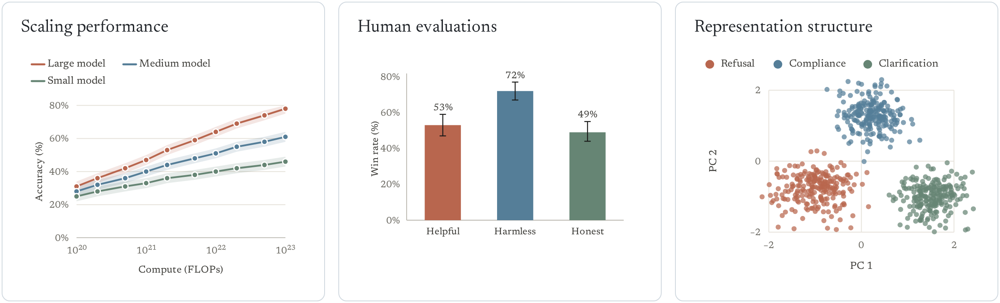

<picture>
  <source media="(prefers-color-scheme: dark)" srcset="docs/readme/dark/hero.png">
  
</picture>

<a href="#quick-start"><picture><source media="(prefers-color-scheme: dark)" srcset="docs/readme/dark/get-started.png"></picture></a>&nbsp;&nbsp;<a href="examples/README.md"><picture><source media="(prefers-color-scheme: dark)" srcset="docs/readme/dark/view-examples.png"></picture></a>



## Why viz?

<table>
<tr>
<td width="25%" valign="top"><picture><source media="(prefers-color-scheme: dark)" srcset="docs/readme/dark/icon-consistent.svg"></picture><br><br><b>Consistent</b><br>One visual language across a write-up: color roles, sizes and type that stay the same from figure to figure.</td>
<td width="25%" valign="top"><picture><source media="(prefers-color-scheme: dark)" srcset="docs/readme/dark/icon-quality.svg"></picture><br><br><b>High quality</b><br>Publication-ready by default: PDFs at the printed size, accessible color and text, and alt text on every figure.</td>
<td width="25%" valign="top"><picture><source media="(prefers-color-scheme: dark)" srcset="docs/readme/dark/icon-research.svg"></picture><br><br><b>Research-focused</b><br>The charts research needs: every run as a dot, effects with intervals, training curves and transcripts.</td>
<td width="25%" valign="top"><picture><source media="(prefers-color-scheme: dark)" srcset="docs/readme/dark/icon-productive.svg"></picture><br><br><b>Productive</b><br>One call per chart, a gallery to copy, and checks that flag problems before anyone reads the figure.</td>
</tr>
</table>

## Quick start

```bash
gh repo clone safety-research/viz && viz/install.sh
```

```python
import viz

viz.hbar({"Plain RL": 41, "Hacking penalty": 28, "Inoculation prompt": 12}, highlight="Inoculation prompt",
         roles={"control": "Plain RL", "intervention": "Inoculation prompt"},
         notes={"Plain RL": "164 of 400", "Hacking penalty": "112 of 400", "Inoculation prompt": "48 of 400"},
         title="The inoculation prompt cut reward hacking from 41% to 12%").save("fig.png")
```


`.save()` writes PNG, PDF, SVG or HTML, by the file's extension.

## Gallery

Every figure is a template for one kind of question. Click one for its code, copy it and change the numbers.
Every number here is made up, and error bars and bands are 95% intervals.

<!-- gallery: generated from src/viz/gallery.py -->
### Comparisons

Rates across conditions and models, with their intervals.

<a href="examples/README.md#rates-by-condition"></a>
<a href="examples/README.md#grouped-bars"></a>
<a href="examples/README.md#bars-with-every-seed"></a>
<a href="examples/README.md#effect-sizes-with-intervals"></a>
<a href="examples/README.md#outcome-breakdown"></a>

### Training dynamics

A behavior or reward over training steps.

<a href="examples/README.md#curves-with-every-seed"></a>
<a href="examples/README.md#several-models-over-training"></a>
<a href="examples/README.md#smoothed-rl-reward"></a>
<a href="examples/README.md#events-on-a-curve"></a>
<a href="examples/README.md#shares-over-training"></a>

### Evaluations

Many models on many evals, trade-offs and scaling.

<a href="examples/README.md#models-on-benchmarks"></a>
<a href="examples/README.md#results-table"></a>
<a href="examples/README.md#attacks-by-model"></a>
<a href="examples/README.md#two-measures-per-model"></a>
<a href="examples/README.md#trade-off-frontier"></a>
<a href="examples/README.md#scaling-law"></a>

### Monitors and probes

How well a monitor, classifier or probe catches a behavior.

<a href="examples/README.md#roc-curves"></a>
<a href="examples/README.md#score-distributions"></a>
<a href="examples/README.md#confusion-matrix"></a>
<a href="examples/README.md#probe-accuracy-by-layer"></a>

### Interpretability

Inside the model: activations, scores on each token, steering.

<a href="examples/README.md#activations-in-2d"></a>
<a href="examples/README.md#token-scores"></a>
<a href="examples/README.md#steering-strength"></a>

### Self-reports and ratings

What a model says about itself, and how judges rate it.

<a href="examples/README.md#self-reports-on-a-scale"></a>
<a href="examples/README.md#ratings-before-and-after"></a>

### Distributions

Many values per condition, such as lengths, times or scores per item.

<a href="examples/README.md#histogram"></a>
<a href="examples/README.md#box-plot"></a>
<a href="examples/README.md#dots-per-item"></a>

### Transcripts

What the model said and did.

<a href="examples/README.md#contrasting-replies"></a>
<a href="examples/README.md#transcripts-side-by-side"></a>
<a href="examples/README.md#agent-with-tool-calls"></a>

### Multi-panel figures

Several charts in one figure, with one legend.

<a href="examples/README.md#panels-with-one-legend"></a>
<!-- /gallery -->

## Learn more

- [Guide](docs/guide.md): how to title, color and size a figure, and what the checks flag.
- [Reference](docs/reference.md): every chart and option, the command line and JSON specs.
- [Examples](examples/README.md): every template with its code.
