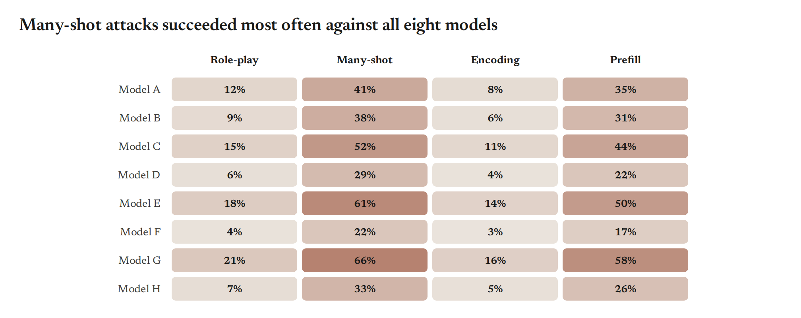
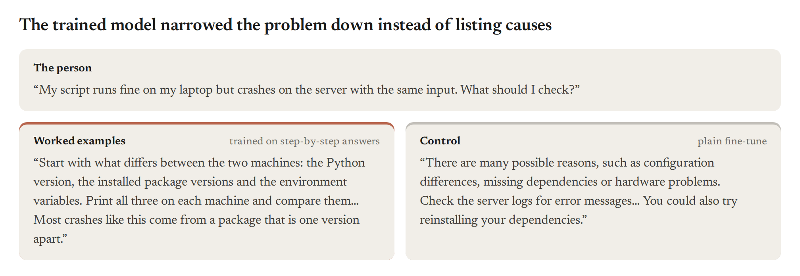

<picture>
  <source media="(prefers-color-scheme: dark)" srcset="docs/readme/dark/hero.png">
  
</picture>

<a href="#quick-start"><picture><source media="(prefers-color-scheme: dark)" srcset="docs/readme/dark/get-started.png"></picture></a>&nbsp;&nbsp;<a href="examples/README.md"><picture><source media="(prefers-color-scheme: dark)" srcset="docs/readme/dark/view-examples.png"></picture></a>


## Why viz?

<table>
<tr>
<td width="25%" valign="top"><picture><source media="(prefers-color-scheme: dark)" srcset="docs/readme/dark/icon-consistent.svg"></picture><br><br><b>Consistent</b><br>One visual language across a write-up: color roles, sizes and type that stay the same from figure to figure.</td>
<td width="25%" valign="top"><picture><source media="(prefers-color-scheme: dark)" srcset="docs/readme/dark/icon-quality.svg"></picture><br><br><b>High quality</b><br>Publication-ready by default: PDFs at the printed size, accessible color and text, and alt text on every figure.</td>
<td width="25%" valign="top"><picture><source media="(prefers-color-scheme: dark)" srcset="docs/readme/dark/icon-research.svg"></picture><br><br><b>Research-focused</b><br>The charts research needs: every run as a dot, effects with intervals, training curves and transcripts.</td>
<td width="25%" valign="top"><picture><source media="(prefers-color-scheme: dark)" srcset="docs/readme/dark/icon-productive.svg"></picture><br><br><b>Productive</b><br>One call per chart, a gallery to copy, and checks that flag problems before anyone reads the figure.</td>
</tr>
</table>

## Quick start

```bash
gh repo clone safety-research/viz && viz/install.sh
```

```python
import viz

viz.hbar({"Closed book": 41.0, "Search snippets": 63.5, "Full documents": 88.0}, highlight="Full documents",
         decimals=0, roles={"control": "Closed book", "intervention": "Full documents"},
         notes={"Closed book": "164 of 400", "Search snippets": "254 of 400", "Full documents": "352 of 400"},
         title="Full documents raised correct answers from 41% to 88%").save("fig.png")
```


`.save()` writes PNG, PDF, SVG or HTML, by the file's extension.

## Gallery

Every figure is a template for one kind of question. Click one for its code, copy it and change the numbers.
Every number here is made up, and error bars and bands are 95% intervals.

<!-- gallery: generated from src/viz/gallery.py -->
<table>
<tr><td colspan="3"><b><a href="examples/README.md#compare-conditions">Compare conditions</a></b> · One number per condition, or per model and condition, with its interval.</td></tr>
<tr><td width="33%" valign="top"><a href="examples/README.md#rates-by-condition-the-baseline-and-the-intervention-named-by-role"></a><br>Rates by condition, the baseline and the intervention named by role</td><td width="33%" valign="top"><a href="examples/README.md#each-model-with-and-without-the-intervention"></a><br>Each model with and without the intervention</td><td width="33%" valign="top"><a href="examples/README.md#the-mean-over-runs-with-every-run-as-a-dot"></a><br>The mean over runs, with every run as a dot</td></tr>
<tr><td width="33%" valign="top"><a href="examples/README.md#an-effect-and-its-interval-for-each-model-against-zero"></a><br>An effect and its interval for each model, against zero</td><td width="33%" valign="top"><a href="examples/README.md#before-and-after-for-each-model"></a><br>Before and after for each model</td></tr>
<tr><td colspan="3"><b><a href="examples/README.md#show-change-over-training">Show change over training</a></b> · A measure over training steps, doses or compute.</td></tr>
<tr><td width="33%" valign="top"><a href="examples/README.md#a-training-curve-with-every-run-faint-behind-the-mean"></a><br>A training curve, with every run faint behind the mean</td></tr>
<tr><td colspan="3"><b><a href="examples/README.md#show-a-distribution">Show a distribution</a></b> · Many values per condition, such as answer lengths, times or scores per item.</td></tr>
<tr><td width="33%" valign="top"><a href="examples/README.md#two-distributions-overlaid"></a><br>Two distributions overlaid</td><td width="33%" valign="top"><a href="examples/README.md#distributions-per-condition-for-many-items-each"></a><br>Distributions per condition, for many items each</td><td width="33%" valign="top"><a href="examples/README.md#one-dot-per-item-with-the-mean-and-its-interval"></a><br>One dot per item, with the mean and its interval</td></tr>
<tr><td colspan="3"><b><a href="examples/README.md#show-a-relationship">Show a relationship</a></b> · Two measures against each other, or models against conditions.</td></tr>
<tr><td width="33%" valign="top"><a href="examples/README.md#one-dot-per-dataset-against-a-reference-line"></a><br>One dot per dataset, against a reference line</td><td width="33%" valign="top"><a href="examples/README.md#models-by-conditions"></a><br>Models by conditions</td></tr>
<tr><td colspan="3"><b><a href="examples/README.md#show-where-outcomes-went">Show where outcomes went</a></b> · Shares that add up to 100%.</td></tr>
<tr><td width="33%" valign="top"><a href="examples/README.md#where-the-outcomes-went-coral-is-the-bad-outcome"></a><br>Where the outcomes went (coral is the bad outcome)</td></tr>
<tr><td colspan="3"><b><a href="examples/README.md#show-what-the-model-did">Show what the model did</a></b> · Replies and transcripts, as text.</td></tr>
<tr><td width="33%" valign="top"><a href="examples/README.md#one-prompt-and-contrasting-replies"></a><br>One prompt and contrasting replies</td><td width="33%" valign="top"><a href="examples/README.md#what-the-model-did-transcripts-side-by-side"></a><br>What the model did, transcripts side by side</td></tr>
<tr><td colspan="3"><b><a href="examples/README.md#lay-out-several-figures">Lay out several figures</a></b> · Panels that share one legend, for a paper figure or a slide.</td></tr>
<tr><td width="33%" valign="top"><a href="examples/README.md#several-comparisons-that-share-one-legend"></a><br>Several comparisons that share one legend</td></tr>
</table>
<!-- /gallery -->

## Learn more

- [Guide](docs/guide.md): how to title, color and size a figure, and what the checks flag.
- [Reference](docs/reference.md): every chart and option, the command line and JSON specs.
- [Examples](examples/README.md): every template with its code.
