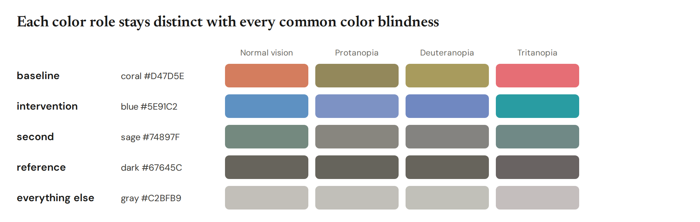

# Making a good figure

The rules viz follows, and how to use its colors, sizes and checks. [The reference](reference.md) lists every
chart and option.

- [Words](#words)
- [Look](#look)
- [Colors](#colors)
- [Sizes](#sizes)
- [Accessibility](#accessibility)
- [Checks](#checks)

## Words

Readers look at a figure's title first and remember it better than the chart, so the title carries the finding
and nothing else on the figure competes with it.

1. **The title states one finding, literally:** what was compared and what happened, in about 10 plain words.
   "With search, wrong answers fell from 59% to 12%", not "Wrong answers by setup" or "Search changes
   everything". If it needs a semicolon, make two figures.
2. **It names what the eye sees first**, the highlighted bar or the biggest gap. If the point is a small
   difference, change the chart (highlight it, drop other bars), not the words.
3. **It says what was measured, not what it means:** "rated the episode higher", not "felt better"; "chose to
   stop", not "wanted to stop".
4. **Plain words only.** No colon setups ("The fix: search"), mirrored phrasing ("A moved without B, and B
   without A"), metaphors, wordplay or questions, and no names coined inside a project, such as an arm's code
   name. Use numbers instead of adjectives: "fell from 41% to 28%", not "dropped sharply". Field terms the
   readers use daily are fine.
5. **No subtitle by default.** Add one only to say "Example data" when the numbers are made up, or what the
   error bars are ("Error bars are 95% intervals"). The measure and unit go in the axis label, or in the title
   when the chart has no axis label. Sample sizes, methods, training details and model names go in the text.
   If the measure needs a sentence to explain, show a simpler measure.
6. **Numbers are written as measured.** viz prints every value with the digits it has and never rounds it, so
   don't round for the reader either: the title quotes the numbers the figure shows (41.3%, not "about 41%").
   Each condition keeps one name across a write-up.

## Look

7. **Keep color meanings fixed across a write-up**: name the conditions once with `viz.set_roles` or a
   `viz-roles.json` (see [Colors](#colors)). The control is gray; the interventions take orange, blue, sage,
   purple and ochre in that order; everything else is light gray.
8. **Mute what isn't the point.** Conditions without a role go gray. Without roles, `highlight=` puts the accent on
   the bar you are talking about; with roles, it bolds that bar's label.
9. **Put categories in order of their values** (`sort=True`: largest first; `sort="asc"`: smallest first) unless
   their order means something, such as model release, size or training step. The checks warn about categories
   out of order; `sort=False` keeps a chosen order without the warning.
10. **Label directly.** Write values at the bar tip and names at line ends, and keep legends small.
   Notes such as "412 chats" or "352 of 400" go after the value.
11. **Show intervals** (`ci=`) when the comparison depends on them, and say what they are in the subtitle.
12. **Mark example data** in the subtitle of any figure made before the real numbers exist.
13. **No caption at the bottom**, in the figure or under it in a write-up.

Titles, labels, ticks and legends are set in Newsreader, a serif; `viz.set_defaults(font="sans")` switches
labels, ticks and legends to DM Sans.

For a write-up, use `frame="blog"`. It gives a centered serif title and subtitle, with the legend below the chart.
`viz.set_defaults(frame="blog")` switches every figure.

For a dark page, such as slides or a dark-mode doc, `viz.set_defaults(theme="dark")` (or `viz --theme dark ...`)
draws light text on GitHub's dark gray, #0D1117. The five intervention colors stay the same, the grays dim, and the
ordered ramp runs from dim to bright.

## Colors

Name the conditions once per write-up, and every figure colors them the same way:

```python
viz.set_roles(control="Closed book", intervention=["With search", "Search"], second="Rerank")
```

| Role | Color | For |
|---|---|---|
| `control` | light gray | the condition without the intervention: the baseline, the untrained model (`baseline` works too) |
| `intervention` | orange | what the figure is about |
| `second` | blue | a second intervention |
| `third` | sage | a third |
| `fourth` | purple | a fourth |
| `fifth` | ochre | a fifth |
| `ordered` | light to dark blue | conditions with an order, such as doses, model sizes or training steps |
| everything else | light gray | muted, so the named conditions stand out; muted series take three shades in turn |

A reference such as chance or the base model is a dashed `ref=` line, not a color. In a chart of outcomes rather
than conditions (right, unsure, wrong), blue, beige and orange mark good, neutral and bad. Role names work anywhere
a color does, so a legend can say `{"Search": "intervention"}` and stay in step with the roles.

- **One file for a write-up.** A `viz-roles.json` in the working folder or any folder above it,
  `{"baseline": "Closed book", "intervention": ["With search"]}`, sets the roles for every script and agent working
  there. `viz roles` shows the roles in effect and where they came from; `viz.set_roles` replaces them for one
  script.
- **Exact names.** Roles match labels exactly. The checks flag a figure where no label has a role, and a muted label
  that looks like a role's ("With search (n=400)" next to "With search").
- **Per chart.** One chart can add roles with `roles={"second": "Rerank"}`, and a JSON spec takes the same
  `"roles"` key. Explicit `colors=` still win. A figure keeps the roles in effect when it was made.

Without roles, several series take orange, blue, sage, purple and ochre, in that order, then the muted shades, and
a chart with one color, or one highlighted bar, takes orange, so the accent is the same in every figure. Heatmaps
shade in orange (`coral`) by default; `blue`, `sage`, `green` and `diverging` are the other scales. `viz colors` prints all
of this, and `viz colors -o colors.png` draws the card below.



## Sizes

Pick the size for where the figure goes. Every figure of one size has the same width, the same plot height for
bar, line, scatter and distribution charts, so figures line up, and text that comes out at the right size there.

| Size | Width | For | PNG |
|---|---|---|---|
| `screen` (default) | 1008 px | posts, web pages, notebooks | 2016 px wide |
| `slide` | 16:9 | a full slide; labels show at about 18 pt and titles at 33 pt | 1920 × 1080 |
| `paper` | 6.75 in | the full text width of a two-column paper; labels print at 8 pt | 300 dpi |
| `column` | 3.25 in | one column of that paper; titles of about five words | 300 dpi |

```python
viz.set_defaults(size="paper")   # every figure in the script
viz.bars(data, size="column")    # one figure
```

PDFs and SVGs come out at the printed width, so `\includegraphics{fig.pdf}` needs no scaling. For another
format, make a `viz.Size`: a one-column NeurIPS page (5.5 in) is `viz.Size(width=610, plot=260, title=16, inches=5.5)`.

## Accessibility

- All text reaches 4.5:1 contrast with what it sits on, including labels on colored fills (viz picks white or
  ink, whichever contrasts more), and no text is smaller than 12 px, except the raised exponent in a
  log-axis tick such as 10²⁰.
- The intervention colors reach 3:1 against the white background and the dark theme's; the gray control is
  context, and its value is labeled like every bar's. The control and the first three interventions (orange,
  blue, sage) stay at least 10 CIEDE2000 apart for normal vision and the red-green color blindnesses; blue and
  sage come closer for the rare tritanopia. Purple and ochre are near blue and orange for red-green color-blind
  readers, so a figure with four or five interventions relies on its labels, and the checks warn when such a pair
  shares a figure. `tests/test_access.py` holds these numbers. The light grays are context, so values on them are
  always labeled.
- Values are labeled directly, so no reading depends on color alone.
- Every figure carries alt text with its data. `fig.alt_text()` gives "Search cut wrong answers for all ten models.
  Bar chart. Model A: Closed book 12%, With search 4%; ..."; use it as the image's alt text in a write-up.
  `viz render --alt` prints it for specs, and SVG and HTML output carry it as `<title>` and `<desc>`.

## Checks

Saving a figure checks it against the style rules and warns about each problem:

```
VizCheck: viz check (fig.png): Title has a semicolon, which means two findings; make two figures.
```

They flag a title that runs long, splits on a semicolon, sets up with a colon, asks a question, breaks for a dash,
ends in punctuation or leans on an intensifier ("dramatically", "far more"); any subtitle other than "Example data"
or what the error bars are; more than four accent colors;
two colors color-blind readers can't tell apart; and a condition whose color changed from an earlier figure in the
same run. `fig.check()` returns the list, `viz check spec.json` checks specs without rendering, and
`viz.set_defaults(checks="error")` turns the warnings into errors (`"off"` skips them). The checks can't tell whether
a title is true or the chart is the right one.
