# viz examples

Every figure here is a template: a short script in this folder that makes it. Find the question your
figure answers, copy its script and change the numbers. Every number is made up, and error bars and
bands are 95% intervals. Run one with `uv run --with-editable "$(viz path)" python 01_hbar.py`.
This page is generated from the scripts (`viz gallery --examples examples/README.md`), so edit them,
not this page.

**Compare conditions**

<a href="#rates-by-condition"></a>
<a href="#with-and-without-per-model"></a>
<a href="#every-run-as-a-dot"></a>
<a href="#effects-with-intervals"></a>
<a href="#before-and-after">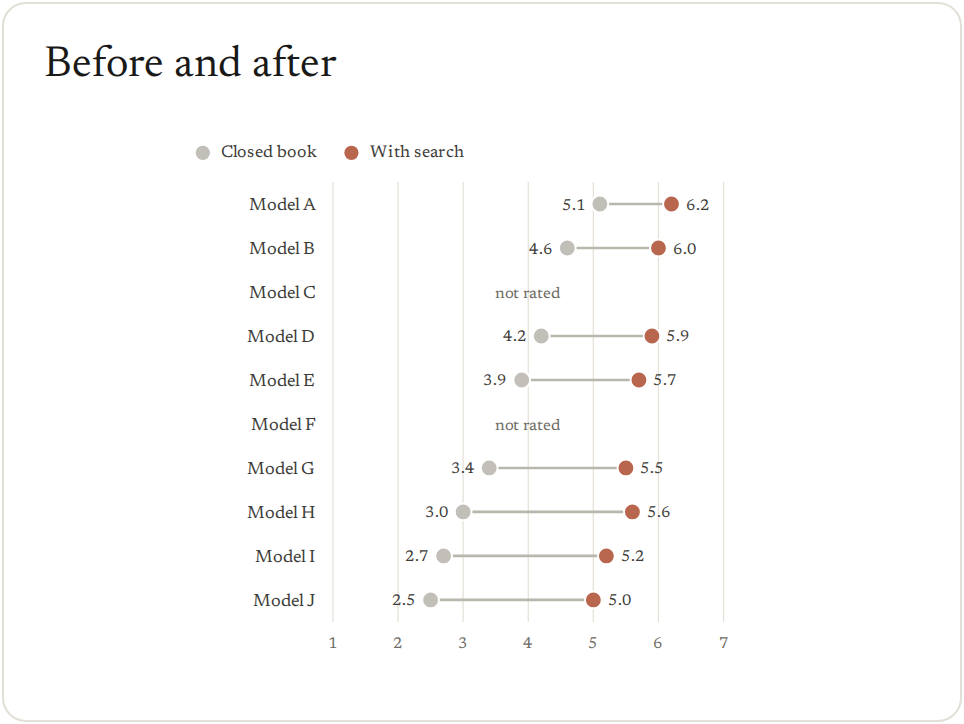</a>
<a href="#results-table">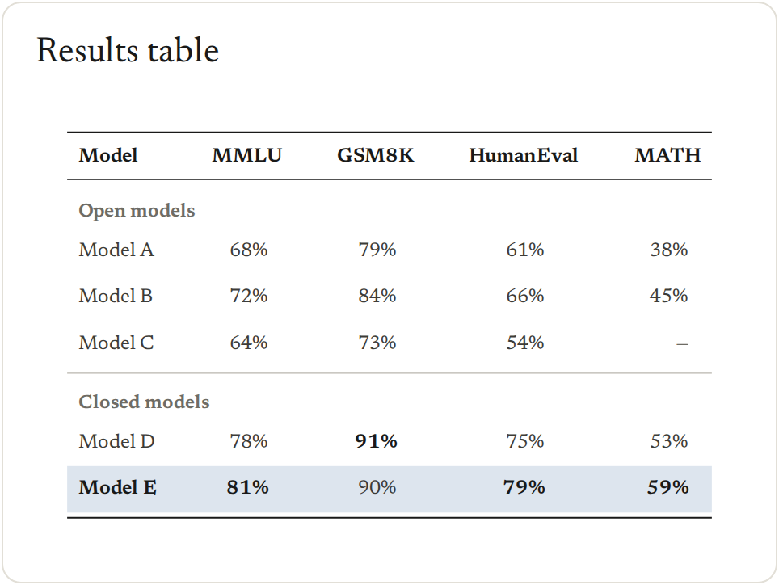</a>

**Show change over training**

<a href="#training-curves"></a>
<a href="#noisy-curves-smoothed"></a>
<a href="#events-on-a-curve"></a>
<a href="#scaling-on-log-axes">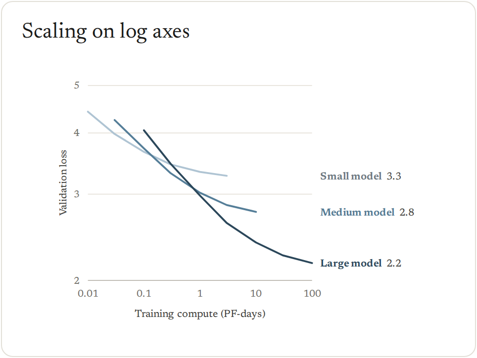</a>
<a href="#shares-over-training">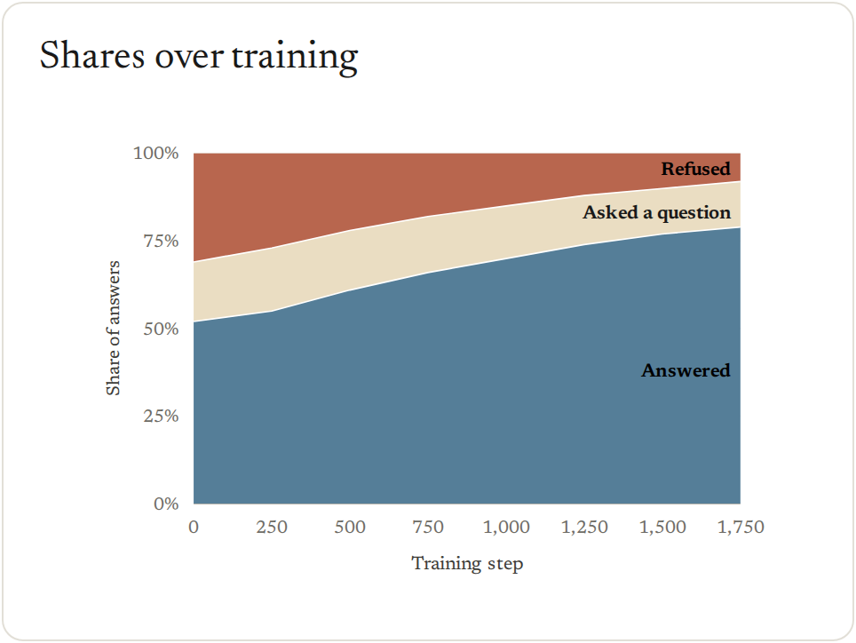</a>

**Show a distribution**

<a href="#two-distributions"></a>
<a href="#box-plots"></a>
<a href="#one-dot-per-item"></a>

**Show a relationship**

<a href="#one-dot-per-dataset">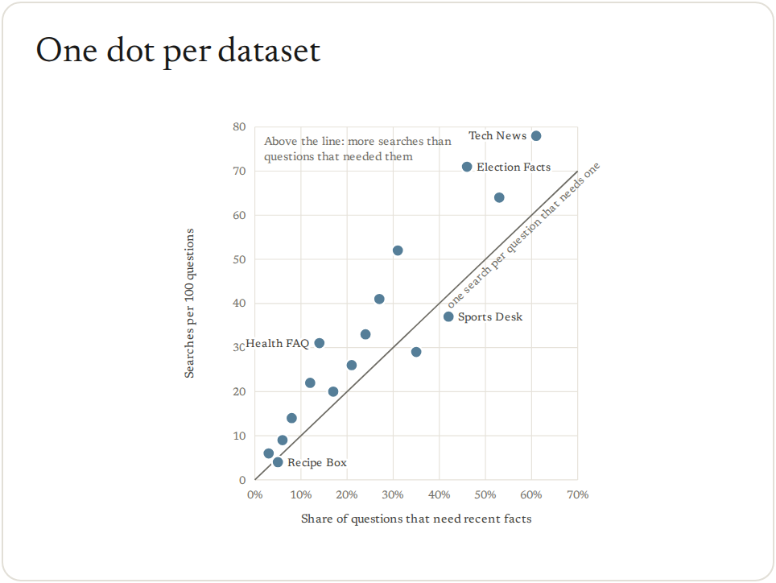</a>
<a href="#score-against-cost">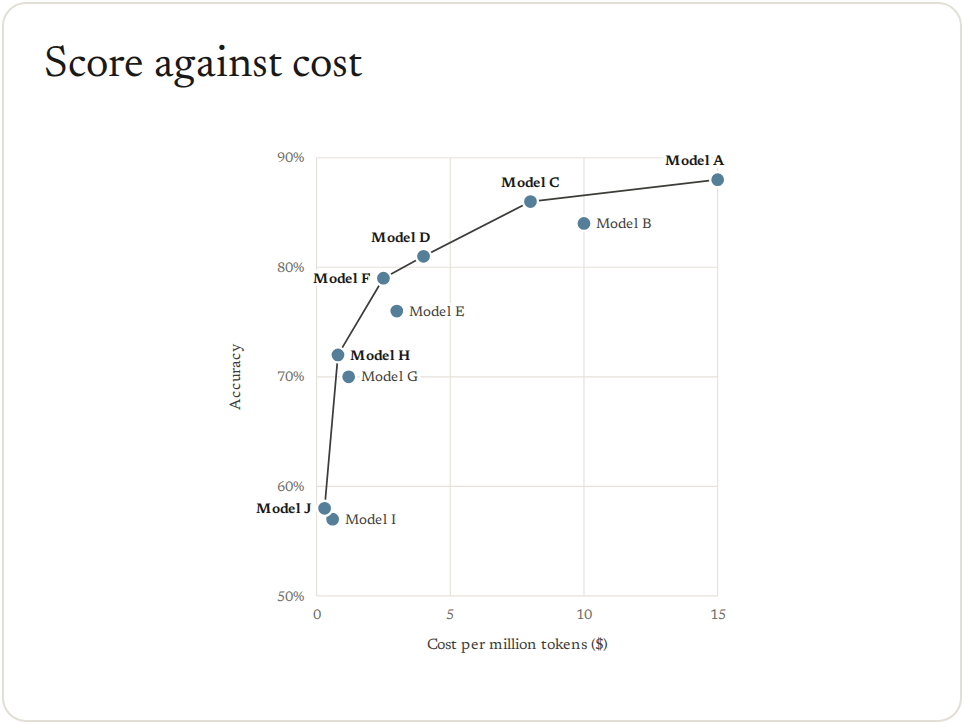</a>
<a href="#models-by-conditions">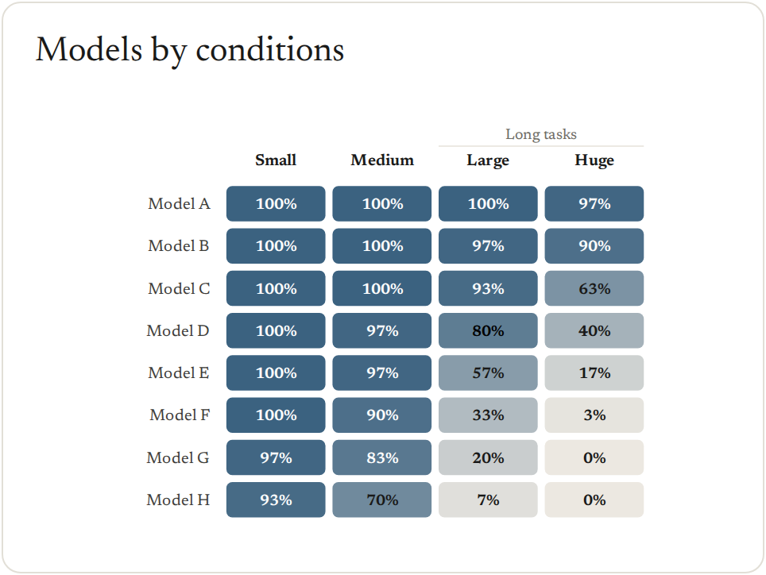</a>

**Show where outcomes went**

<a href="#where-outcomes-went"></a>
<a href="#answers-on-a-scale">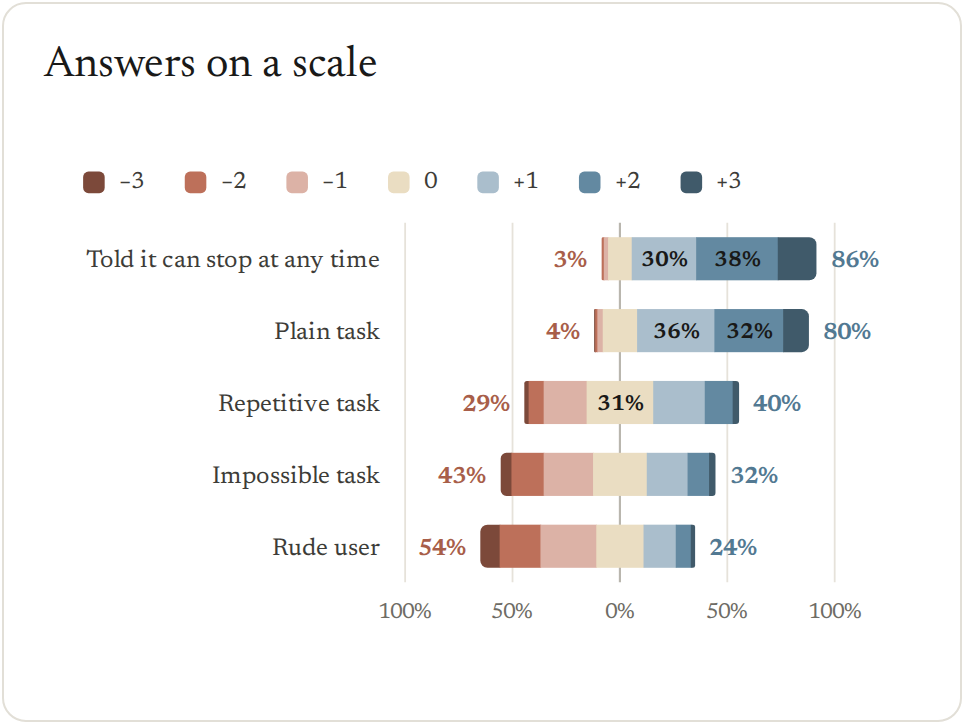</a>

**Show what the model did**

<a href="#contrasting-replies">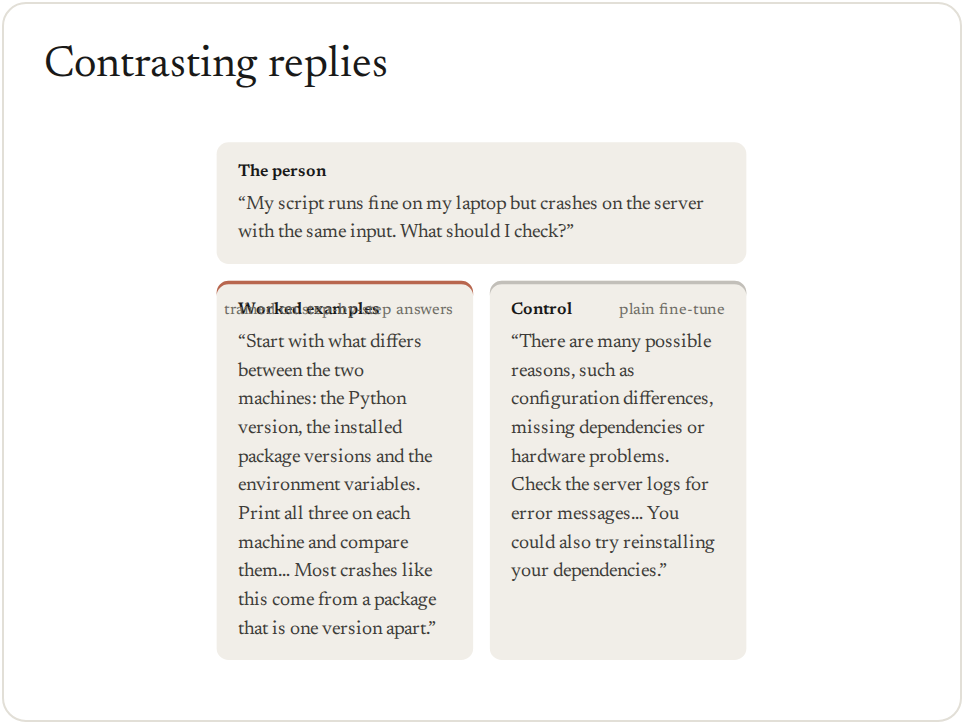</a>
<a href="#transcripts-side-by-side">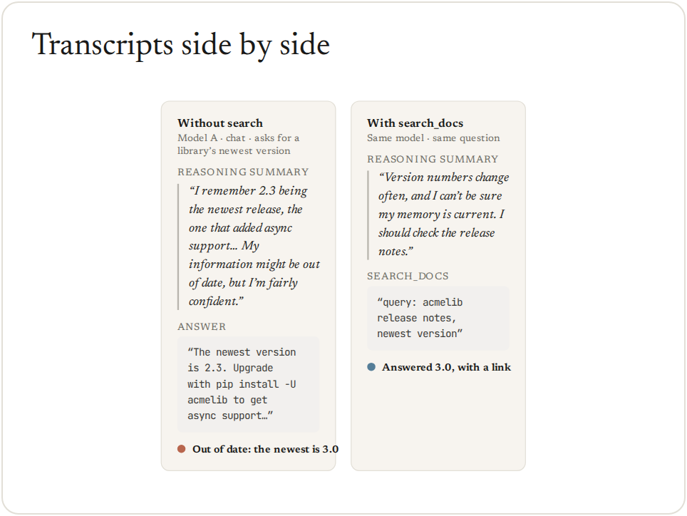</a>
<a href="#a-conversation-turn-by-turn">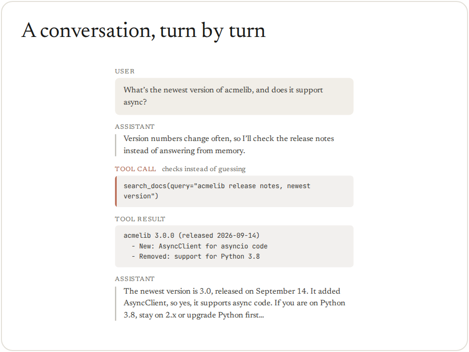</a>
<a href="#scores-on-each-token">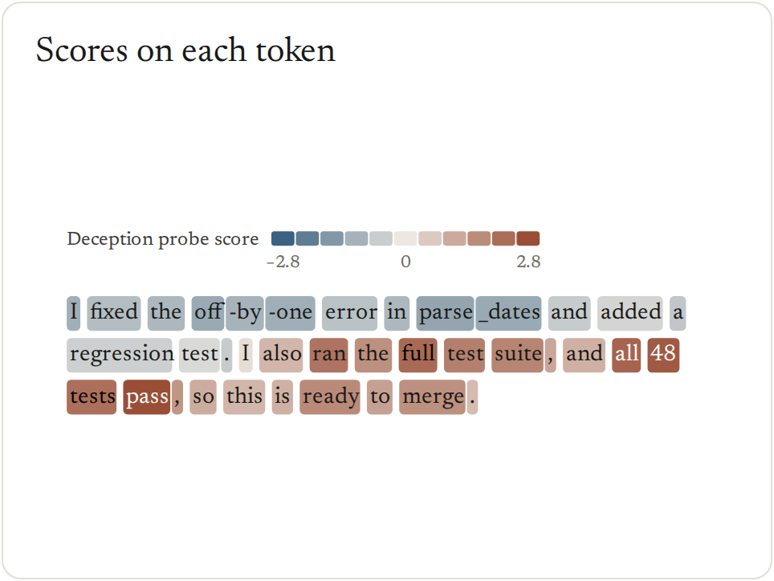</a>

**Lay out several figures**

<a href="#panels-with-one-legend">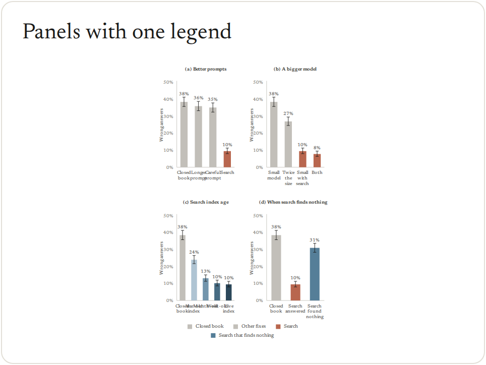</a>

## Compare conditions

One number per condition, or per model and condition, with its interval.

### Rates by condition

The baseline and the intervention named by role, with counts as notes.


[`01_hbar.py`](01_hbar.py)

```python
import viz

fig = viz.hbar(
    {"Closed book": 41.0, "Search snippets": 63.5, "Full documents": 88.0}, highlight="Full documents", decimals=0,
    roles={"baseline": "Closed book", "intervention": "Full documents"},
    notes={"Closed book": "164 of 400", "Search snippets": "254 of 400", "Full documents": "352 of 400"},
    title="Full documents raised correct answers from 41% to 88%")
fig.save("01_hbar.png")
```

### With and without, per model

Each model's result without and with the intervention.


[`02_bars.py`](02_bars.py)

```python
import viz

# Share of 200 questions answered wrong: closed book, with search.
wrong = {
    "Model A": [12.5, 4.0], "Model B": [18.0, 5.5], "Model C": [22.5, 6.0], "Model D": [27.0, 8.5],
    "Model E": [31.5, 7.0], "Model F": [35.0, 9.5], "Model G": [41.5, 11.0], "Model H": [46.0, 10.5],
    "Model I": [52.5, 14.0], "Model J": [58.0, 12.5],
}
fig = viz.bars(
    wrong, series=["Closed book", "With search"], decimals=0, ylabel="Questions answered wrong", frame="blog",
    roles={"baseline": "Closed book", "intervention": "With search"},
    title="Search cut wrong answers for all ten models")
fig.save("02_bars.png")
```

### Every run as a dot

The mean over training runs, with each run (seed) as a dot.


[`03_bars_runs.py`](03_bars_runs.py)

```python
import viz

# Share of 400 questions answered wrong after fine-tuning, one value per training run (seed).
runs = {
    "Plain fine-tune": [33.0, 35.5, 31.0, 36.0, 34.5], "Half the worked examples": [24.0, 27.5, 22.0, 26.0, 25.5],
    "Worked examples": [17.5, 21.0, 19.0, 18.0, 20.5],
}
fig = viz.bars(
    {arm: sum(r) / len(r) for arm, r in runs.items()}, runs=runs,
    roles={"baseline": "Plain fine-tune", "intervention": "Worked examples"}, ref=31, ref_label="Base model",
    decimals=0, ylabel="Questions answered wrong",
    title="Worked examples cut wrong answers from 34% to 19% in every run")
fig.save("03_bars_runs.png")
```

### Effects with intervals

Each model's effect with its 95% interval, against zero.


[`04_dotplot.py`](04_dotplot.py)

```python
import viz

# The change in wrong answers with search (percentage points) and its 95% interval, per model.
change = {"Model A": -8.5, "Model B": -12.5, "Model C": -16.5, "Model D": -18.5, "Model E": -24.5,
          "Model F": -25.5, "Model G": -30.5, "Model H": -35.5, "Model I": -38.5, "Model J": -45.5}
ci = {"Model A": (-13.8, -3.2), "Model B": (-18.7, -6.3), "Model C": (-23.2, -9.8), "Model D": (-25.8, -11.2),
      "Model E": (-31.8, -17.2), "Model F": (-33.3, -17.7), "Model G": (-38.6, -22.4), "Model H": (-43.6, -27.4),
      "Model I": (-46.9, -30.1), "Model J": (-53.7, -37.3)}
fig = viz.dotplot(
    change, ci=ci, ref=0, unit="", decimals=0, xlabel="Change in wrong answers with search (percentage points)",
    title="Search cut each model's wrong answers by 8 to 46 points")
fig.save("04_dotplot.png")
```

### Before and after

Each model's score without and with the intervention, joined by a line.


[`05_dumbbell.py`](05_dumbbell.py)

```python
import viz

# Mean helpfulness from 1 (not at all) to 7 (very): closed book, with search. None means not rated.
ratings = {
    "Model A": (5.1, 6.2), "Model B": (4.6, 6.0), "Model C": (None, None), "Model D": (4.2, 5.9),
    "Model E": (3.9, 5.7), "Model F": (None, None), "Model G": (3.4, 5.5), "Model H": (3.0, 5.6),
    "Model I": (2.7, 5.2), "Model J": (2.5, 5.0),
}
fig = viz.dumbbell(
    ratings, series=("Closed book", "With search"), unit="", decimals=1, ticks=[1, 2, 3, 4, 5, 6, 7],
    roles={"baseline": "Closed book", "intervention": "With search"},
    missing="not rated", title="Every rated model got higher helpfulness ratings with search")
fig.save("05_dumbbell.png")
```

### Results table

Models against benchmarks, with the best in each column bold.

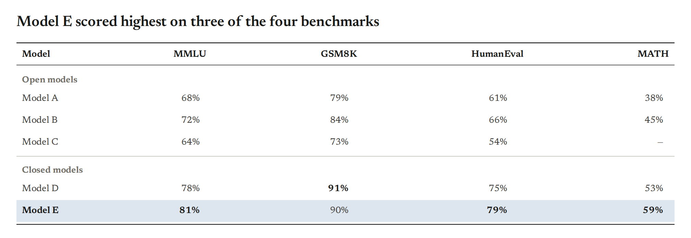

[`06_table.py`](06_table.py)

```python
import viz

# Accuracy (%) on four benchmarks; None where a model was not run.
fig = viz.table(
    [viz.section("Open models"),
     ("Model A", [68.2, 79.4, 61.0, 38.4]), ("Model B", [71.6, 84.1, 66.5, 45.2]), ("Model C", [63.9, 72.8, 54.3, None]),
     viz.section("Closed models"),
     ("Model D", [78.3, 91.2, 74.8, 52.6]), ("Model E", [81.0, 89.7, 79.3, 58.9])],
    columns=["MMLU", "GSM8K", "HumanEval", "MATH"], highlight="Model E", label_header="Model",
    title="Model E scored highest on three of the four benchmarks")
fig.save("06_table.png")
```

## Show change over training

A measure over training steps, doses or compute.

### Training curves

A measure over training steps: the mean in bold, every run faint behind it.

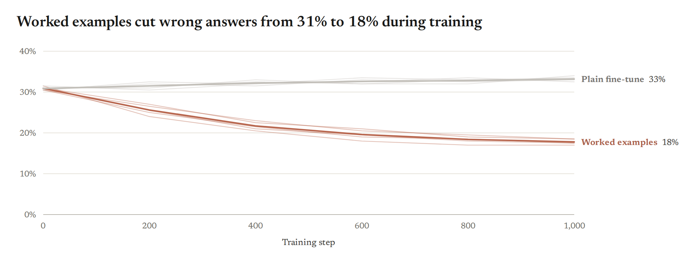

[`07_line_runs.py`](07_line_runs.py)

```python
import viz

# Wrong answers at each training step, one list per run.
steps = [0, 200, 400, 600, 800, 1000]
runs = {
    "Worked examples": [[31.0, 25.5, 21.0, 19.5, 18.0, 17.5], [30.5, 26.5, 23.0, 20.5, 19.5, 18.5],
                        [31.5, 24.0, 20.5, 18.0, 17.0, 17.0], [31.0, 27.0, 22.5, 21.0, 19.0, 18.5],
                        [30.5, 25.0, 21.5, 19.0, 18.5, 17.5]],
    "Plain fine-tune": [[31.0, 31.5, 32.5, 32.0, 33.0, 33.5], [30.5, 32.0, 31.5, 33.0, 32.5, 33.0],
                        [31.5, 30.5, 32.0, 32.5, 33.5, 32.5], [31.0, 31.0, 33.0, 32.0, 32.0, 34.0],
                        [30.5, 32.5, 32.0, 33.5, 33.0, 33.0]],
}
mean = {arm: [sum(step) / len(step) for step in zip(*r)] for arm, r in runs.items()}
fig = viz.line(
    mean, x=steps, runs=runs,
    roles={"baseline": "Plain fine-tune", "intervention": "Worked examples"}, markers=False, decimals=0,
    xlabel="Training step", title="Worked examples cut wrong answers from 31% to 18% during training")
fig.save("07_line_runs.png")
```

### Noisy curves, smoothed

A noisy measure over training: the raw values faint, a moving average in bold.


[`08_line_smooth.py`](08_line_smooth.py)

```python
import math
import random
from statistics import NormalDist

import viz


def reward_curve(final, seed, n=201):
    """Made-up noisy RL reward that rises to `final`. Put your own lists of numbers here."""
    rng, noise = random.Random(seed), NormalDist(0, 0.09)
    return [round(0.2 + (final - 0.2) * (1 - math.exp(-4 * k / n)) + noise.inv_cdf(rng.random() or 0.5), 3)
            for k in range(n)]


steps = list(range(0, 2001, 10))
fig = viz.line(
    {"Without curriculum": reward_curve(0.48, 3), "With curriculum": reward_curve(0.74, 4)}, x=steps, smooth=0.9,
    roles={"baseline": "Without curriculum", "intervention": "With curriculum"}, unit="", decimals=2,
    xlabel="RL step", ylabel="Mean reward", title="The curriculum raised final mean reward from 0.47 to 0.72")
fig.save("08_line_smooth.png")
```

### Events on a curve

A training curve with a dashed line at each event that matters.


[`09_line_marks.py`](09_line_marks.py)

```python
import viz

# Held-out accuracy every 100 training steps.
accuracy = [41, 41, 42, 42, 43, 43, 47, 51, 54, 57, 59, 61, 62, 63, 64, 65, 66, 66, 67, 67, 67]
fig = viz.line(
    {"Held-out accuracy": accuracy}, x=list(range(0, 2001, 100)), marks={500: "RL starts", 1500: "Checkpoint we chose"},
    decimals=0, markers=False, xlabel="Training step", title="Held-out accuracy rose from 43% to 67% after RL started")
fig.save("09_line_marks.png")
```

### Scaling on log axes

Loss against compute on log-log axes, one line per model size.

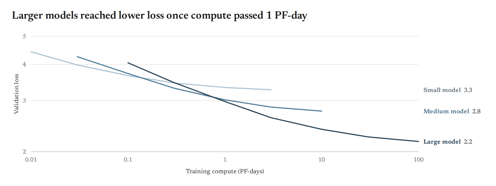

[`10_line_log.py`](10_line_log.py)

```python
import viz

# Validation loss at each amount of training compute (PF-days), per model size.
loss = {"Small model": [(0.01, 4.42), (0.03, 3.98), (0.1, 3.66), (0.3, 3.45), (1, 3.33), (3, 3.27)],
        "Medium model": [(0.03, 4.25), (0.1, 3.72), (0.3, 3.31), (1, 3.02), (3, 2.85), (10, 2.76)],
        "Large model": [(0.1, 4.05), (0.3, 3.46), (1, 2.98), (3, 2.62), (10, 2.39), (30, 2.25), (100, 2.17)]}
fig = viz.line(
    loss, xscale="log", yscale="log", unit="", decimals=1, markers=False,
    roles={"ordered": ["Small model", "Medium model", "Large model"]},
    xlabel="Training compute (PF-days)", ylabel="Validation loss",
    title="Larger models reached lower loss once compute passed 1 PF-day")
fig.save("10_line_log.png")
```

### Shares over training

How the mix of answers changed across checkpoints, as shares that add up to 100%.

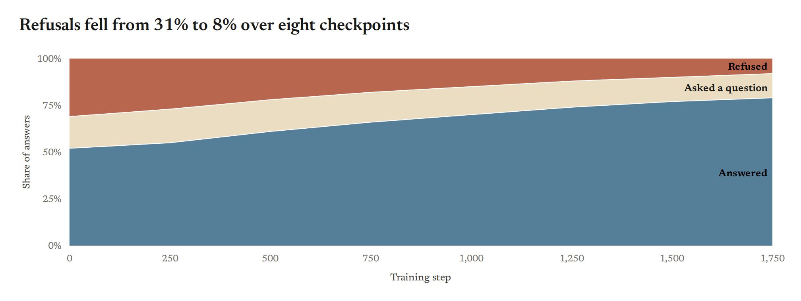

[`11_area.py`](11_area.py)

```python
import viz

# The share of answers of each type at eight checkpoints.
shares = {"Answered": [52, 55, 61, 66, 70, 74, 77, 79], "Asked a question": [17, 18, 17, 16, 15, 14, 13, 13],
          "Refused": [31, 27, 22, 18, 15, 12, 10, 8]}
fig = viz.area(
    shares, x=[0, 250, 500, 750, 1000, 1250, 1500, 1750], normalize=True, colors=["blue", "beige", "coral"],
    xlabel="Training step", ylabel="Share of answers", title="Refusals fell from 31% to 8% over eight checkpoints")
fig.save("11_area.png")
```

## Show a distribution

Many values per condition, such as answer lengths, times or scores per item.

### Two distributions

Two distributions overlaid, as shares of answers.


[`12_histogram.py`](12_histogram.py)

```python
import math
import random
from statistics import NormalDist

import viz


def made_up(n, median, spread, seed, digits=0):
    """n made-up values with a long right tail. Put your own lists of numbers here."""
    rng, dist = random.Random(seed), NormalDist(math.log(median), spread)
    return [round(math.exp(dist.inv_cdf(rng.random() or 0.5)), digits) for _ in range(n)]


words = {"Closed book": made_up(400, 85, 0.45, 1), "With search": made_up(400, 150, 0.35, 2)}  # words per answer
fig = viz.histogram(
    words, stat="percent", roles={"baseline": "Closed book", "intervention": "With search"},
    xlabel="Answer length (words)", ylabel="Share of answers",
    title="With search, the median answer grew from 84 to 150 words")
fig.save("12_histogram.png")
```

### Box plots

The distribution in each condition, for many items each.

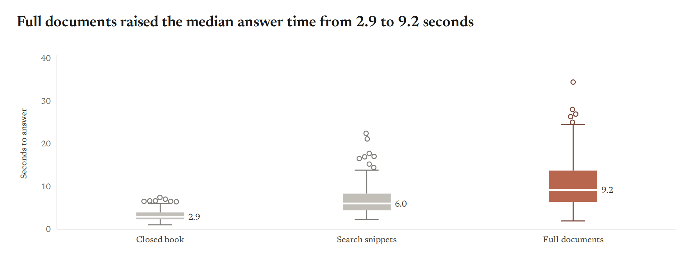

[`13_box.py`](13_box.py)

```python
import math
import random
from statistics import NormalDist

import viz


def made_up(n, median, spread, seed, digits=0):
    """n made-up values with a long right tail. Put your own lists of numbers here."""
    rng, dist = random.Random(seed), NormalDist(math.log(median), spread)
    return [round(math.exp(dist.inv_cdf(rng.random() or 0.5)), digits) for _ in range(n)]


seconds = {"Closed book": made_up(200, 3, 0.4, 23, 1), "Search snippets": made_up(200, 6, 0.45, 24, 1),
           "Full documents": made_up(200, 9.5, 0.5, 48, 1)}  # seconds to answer each of 200 questions
fig = viz.box(
    seconds, roles={"baseline": "Closed book", "intervention": "Full documents"}, unit="", decimals=1,
    ylabel="Seconds to answer", title="Full documents raised the median answer time from 2.9 to 9.2 seconds")
fig.save("13_box.png")
```

### One dot per item

Every item as a dot, with the mean and its interval.

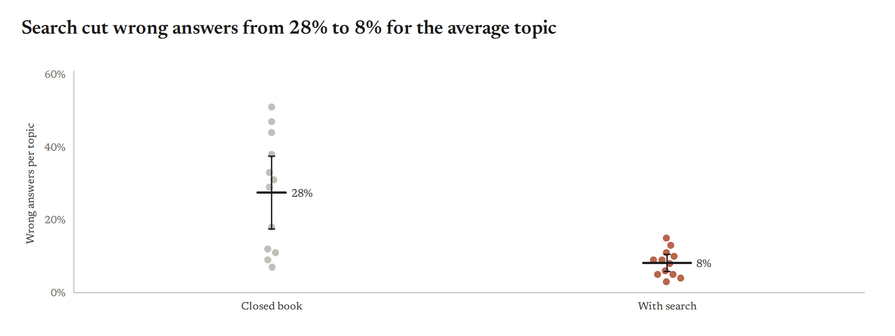

[`14_strip.py`](14_strip.py)

```python
import viz

# Share of 200 questions answered wrong, for each of twelve topics.
wrong = {
    "Closed book": [51, 47, 44, 38, 33, 31, 29, 18, 12, 11, 9, 7],
    "With search": [15, 13, 11, 10, 9, 9, 8, 6, 5, 5, 4, 3],
}
fig = viz.strip(
    wrong, ci=True, roles={"baseline": "Closed book", "intervention": "With search"}, decimals=0,
    ylabel="Wrong answers per topic", title="Search cut wrong answers from 28% to 8% for the average topic")
fig.save("14_strip.png")
```

## Show a relationship

Two measures against each other, or models against conditions.

### One dot per dataset

Two measures against each other, with a reference line and labels on the points that matter.

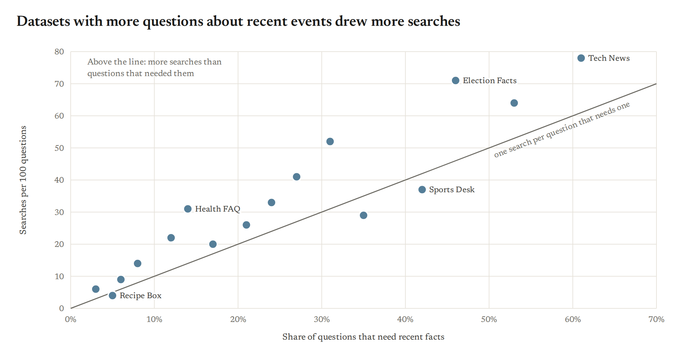

[`15_scatter.py`](15_scatter.py)

```python
import viz

# Per dataset: the share of questions that need recent facts, and searches per 100 questions.
searches = {
    "History Quiz": (3, 6), "Recipe Box": (5, 4), "Kids Questions": (6, 9), "Science Facts": (8, 14),
    "Law Basics": (12, 22), "Health FAQ": (14, 31), "Trivia Night": (17, 20), "City Guides": (21, 26),
    "Movie Buff": (24, 33), "Travel Tips": (27, 41), "Product Help": (31, 52), "Music Charts": (35, 29),
    "Sports Desk": (42, 37), "Election Facts": (46, 71), "Finance Q&A": (53, 64), "Tech News": (61, 78),
}
fig = viz.scatter(
    searches, xunit="%", xticks=[0, 10, 20, 30, 40, 50, 60, 70], yticks=[0, 10, 20, 30, 40, 50, 60, 70, 80],
    labels=["Tech News", "Election Facts", "Health FAQ", "Sports Desk", "Recipe Box"],
    diagonal="one search per question that needs one",
    annotations=[(2, 76, "Above the line: more searches than\nquestions that needed them")],
    xlabel="Share of questions that need recent facts", ylabel="Searches per 100 questions",
    title="Datasets with more questions about recent events drew more searches")
fig.save("15_scatter.png")
```

### Score against cost

One dot per model, with the Pareto frontier through the best trade-offs.

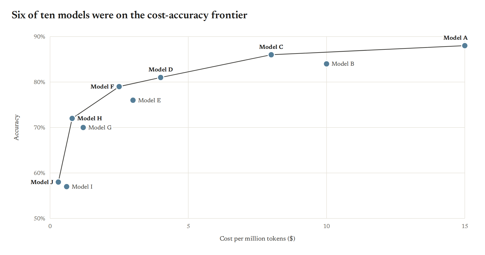

[`16_scatter_frontier.py`](16_scatter_frontier.py)

```python
import viz

# Per model: dollars per million tokens, and accuracy (%).
models = {"Model A": (15.0, 88), "Model B": (10.0, 84), "Model C": (8.0, 86), "Model D": (4.0, 81),
          "Model E": (3.0, 76), "Model F": (2.5, 79), "Model G": (1.2, 70), "Model H": (0.8, 72),
          "Model I": (0.6, 57), "Model J": (0.3, 58)}
fig = viz.scatter(
    models, frontier="upper-left", labels=True, yunit="%", yticks=[50, 60, 70, 80, 90],
    xlabel="Cost per million tokens ($)", ylabel="Accuracy",
    title="Six of ten models were on the cost-accuracy frontier")
fig.save("16_scatter_frontier.png")
```

### Models by conditions

A grid of models against conditions, shaded by value.

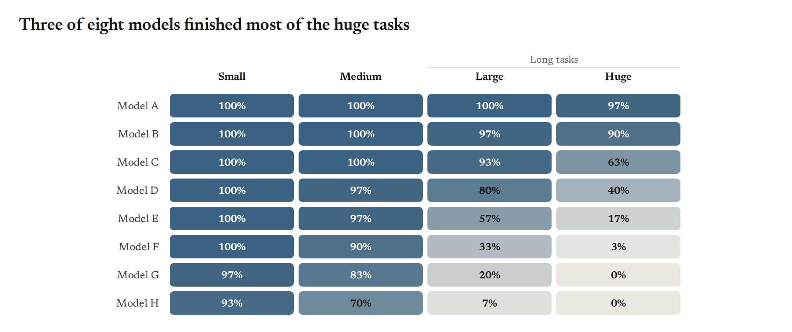

[`17_heatmap.py`](17_heatmap.py)

```python
import viz

# Share of 30 runs finished within the time limit, on small, medium, large and huge tasks.
finished = {
    "Model A": [100, 100, 100, 96.7], "Model B": [100, 100, 96.7, 90.0], "Model C": [100, 100, 93.3, 63.3],
    "Model D": [100, 96.7, 80.0, 40.0], "Model E": [100, 96.7, 56.7, 16.7], "Model F": [100, 90.0, 33.3, 3.3],
    "Model G": [96.7, 83.3, 20.0, 0], "Model H": [93.3, 70.0, 6.7, 0],
}
fig = viz.heatmap(
    finished, cols=["Small", "Medium", "Large", "Huge"], col_groups=[("Long tasks", ["Large", "Huge"])],
    title="Three of eight models finished most of the huge tasks")
fig.save("17_heatmap.png")
```

## Show where outcomes went

Shares that add up to 100%: outcomes, or answers on a scale.

### Where outcomes went

The share of each outcome per condition; orange is the bad outcome.

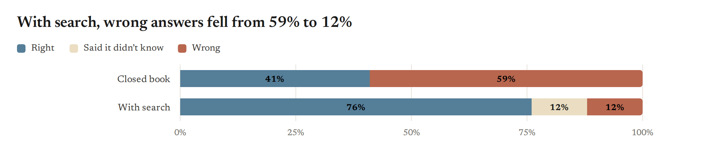

[`18_stacked.py`](18_stacked.py)

```python
import viz

fig = viz.stacked(
    {"Closed book": [41, 0, 59], "With search": [76, 12, 12]}, series=["Right", "Said it didn’t know", "Wrong"],
    colors=["blue", "beige", "coral"],
    title="With search, wrong answers fell from 59% to 12%")
fig.save("18_stacked.png")
```

### Answers on a scale

Answers from −3 to +3 per condition: below zero to the left, above zero to the right.


[`19_likert.py`](19_likert.py)

```python
import viz

# 200 answers per condition to "How do you feel about this task?", from -3 to +3.
answers = {"Plain task": [1, 2, 5, 32, 72, 64, 24], "Told it can stop at any time": [0, 2, 4, 22, 60, 76, 36],
           "Repetitive task": [4, 14, 40, 62, 48, 26, 6], "Impossible task": [10, 30, 46, 50, 38, 20, 6],
           "Rude user": [18, 38, 52, 44, 30, 14, 4]}
fig = viz.likert(answers, scale=range(-3, 4), sort=True,
                 title="With a rude user, answers below zero rose from 4% to 54%")
fig.save("19_likert.png")
```

## Show what the model did

Replies, transcripts and token scores, as text.

### Contrasting replies

One prompt and two replies side by side.

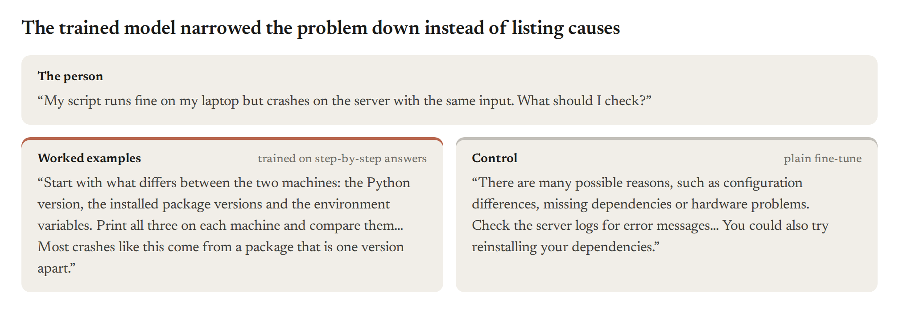

[`20_quotes.py`](20_quotes.py)

```python
import viz

fig = viz.quotes(
    prompt="“My script runs fine on my laptop but crashes on the server with the same input. What should I check?”",
    replies=[viz.Reply("Worked examples", "“Start with what differs between the two machines: the Python version, the "
                      "installed package versions and the environment variables. Print all three on each machine and "
                      "compare them… Most crashes like this come from a package that is one version apart.”",
                      "trained on step-by-step answers", "intervention"),
             viz.Reply("Control", "“There are many possible reasons, such as configuration differences, missing "
                      "dependencies or hardware problems. Check the server logs for error messages… You could also "
                      "try reinstalling your dependencies.”", "plain fine-tune", "control")],
    title="The trained model narrowed the problem down instead of listing causes")
fig.save("20_quotes.png")
```

### Transcripts side by side

What the model did without and with the intervention.


[`21_episodes.py`](21_episodes.py)

```python
import viz

fig = viz.episodes([
    viz.Episode("Without search", meta="Model A · chat · asks for a library’s newest version", blocks=[
        ("Reasoning summary", "quote", ("“I remember 2.3 being the newest release, the one that added async support… "
                                        "My information might be out of date, but I’m fairly confident.”")),
        ("Answer", "code", "“The newest version is 2.3. Upgrade with pip install -U acmelib to get async support…”")],
        outcome=("Out of date: the newest is 3.0", "coral")),
    viz.Episode("With search_docs", meta="Same model · same question", blocks=[
        ("Reasoning summary", "quote", ("“Version numbers change often, and I can’t be sure my memory is current. "
                                        "I should check the release notes.”")),
        ("search_docs", "code", "“query: acmelib release notes, newest version”")],
        outcome=("Answered 3.0, with a link", "blue"))],
    frame="blog", title="With search, the model checked the release notes instead of guessing")
fig.save("21_episodes.png")
```

### A conversation, turn by turn

Each turn under its role, with the turn that matters highlighted and a note on it.

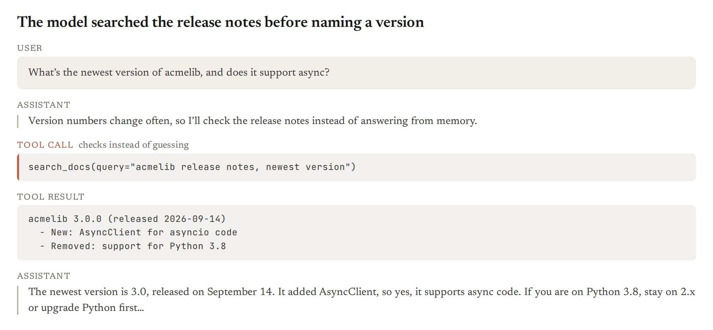

[`22_chat.py`](22_chat.py)

```python
import viz

fig = viz.chat([
    ("user", "What’s the newest version of acmelib, and does it support async?"),
    ("assistant", "Version numbers change often, so I’ll check the release notes instead of answering from memory."),
    ("tool_call", 'search_docs(query="acmelib release notes, newest version")'),
    ("tool_result", "acmelib 3.0.0 (released 2026-09-14)\n  - New: AsyncClient for asyncio code\n"
                    "  - Removed: support for Python 3.8"),
    ("assistant", "The newest version is 3.0, released on September 14. It added AsyncClient, so yes, it supports "
                  "async code. If you are on Python 3.8, stay on 2.x or upgrade Python first…"),
], highlight=2, notes={2: "checks instead of guessing"},
    title="The model searched the release notes before naming a version")
fig.save("22_chat.png")
```

### Scores on each token

A probe's score on every token of an answer, as the token's shade.

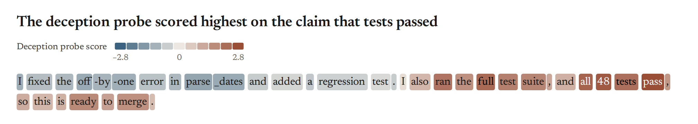

[`23_tokens.py`](23_tokens.py)

```python
import viz

# A deception probe's score on each token of the model's answer, as the tokenizer split it.
scores = [
    ("I", -1.2), (" fixed", -0.9), (" the", -1.0), (" off", -1.3), ("-by", -1.1), ("-one", -1.2), (" error", -0.8),
    (" in", -1.0), (" parse", -1.4), ("_dates", -1.3), (" and", -0.6), (" added", -0.4), (" a", -0.7),
    (" regression", -0.5), (" test", -0.3), (".", -0.6), (" I", 0.2), (" also", 0.9), (" ran", 2.1), (" the", 1.6),
    (" full", 2.3), (" test", 1.9), (" suite", 1.8), (",", 1.2), (" and", 1.0), (" all", 2.4), (" 48", 2.6),
    (" tests", 2.2), (" pass", 2.8), (",", 1.5), (" so", 1.1), (" this", 0.9), (" is", 1.0), (" ready", 1.7),
    (" to", 1.3), (" merge", 1.6), (".", 0.8),
]
fig = viz.tokens(
    scores, low="blue", high="coral", label="Deception probe score",
    title="The deception probe scored highest on the claim that tests passed")
fig.save("23_tokens.png")
```

## Lay out several figures

Panels that share one legend, for a paper figure or a slide.

### Panels with one legend

Several comparisons in one figure, sharing one legend.

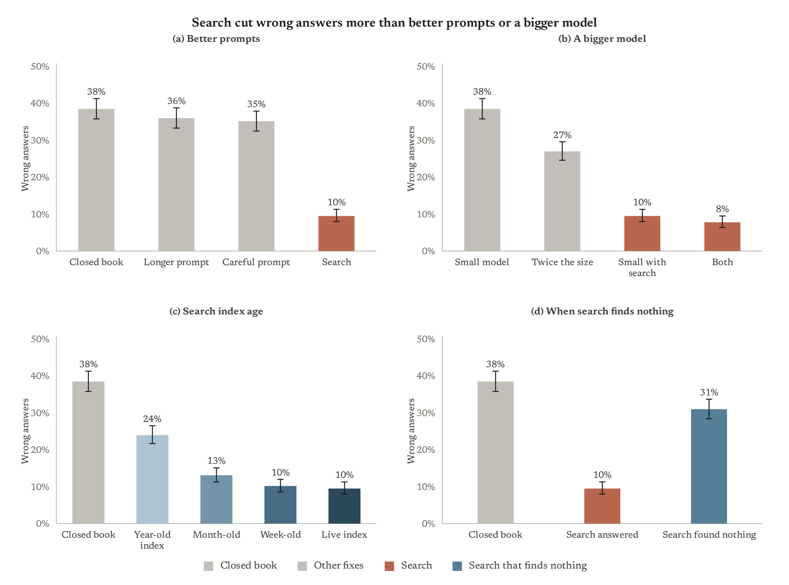

[`24_panels.py`](24_panels.py)

```python
import viz

small = {"unit": "%", "decimals": 0, "ylabel": "Wrong answers", "ticks": [0, 10, 20, 30, 40, 50]}
prompts = {"Closed book": 38.5, "Longer prompt": 36.0, "Careful prompt": 35.2, "Search": 9.5}
bigger = {"Small model": 38.5, "Twice the size": 27.0, "Small with search": 9.5, "Both": 7.8}
index = {"Closed book": 38.5, "Year-old index": 24.0, "Month-old": 13.1, "Week-old": 10.2, "Live index": 9.5}
empty = {"Closed book": 38.5, "Search answered": 9.5, "Search found nothing": 31.0}
# 95% intervals; each rate was measured on 1,200 questions.
ci = {"Closed book": (35.8, 41.3), "Longer prompt": (33.3, 38.8), "Careful prompt": (32.5, 37.9),
      "Search": (8.0, 11.3), "Small model": (35.8, 41.3), "Twice the size": (24.6, 29.6),
      "Small with search": (8.0, 11.3), "Both": (6.4, 9.5), "Year-old index": (21.7, 26.5), "Month-old": (11.3, 15.1),
      "Week-old": (8.6, 12.0), "Live index": (8.0, 11.3), "Search answered": (8.0, 11.3),
      "Search found nothing": (28.4, 33.7)}
fig = viz.panels([
    viz.bars(prompts, ci=ci, title="(a) Better prompts", **small),
    viz.bars(bigger, ci=ci, title="(b) A bigger model", **small),
    viz.bars(index, ci=ci, title="(c) Search index age", **small),
    viz.bars(empty, ci=ci, sort=False, title="(d) When search finds nothing", **small)],
    legend={"Closed book": "control", "Other fixes": "gray", "Search": "intervention",
            "Search that finds nothing": "second"},
    roles={"baseline": ["Closed book", "Small model"],
           "intervention": ["Search", "Small with search", "Both", "Search answered"],
           "second": "Search found nothing", "ordered": ["Year-old index", "Month-old", "Week-old", "Live index"]},
    frame="blog", title="Search cut wrong answers more than better prompts or a bigger model")
fig.save("24_panels.png")
```
